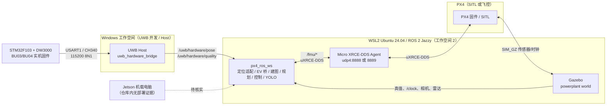

# 室内无人机项目：系统架构总览（决策者版）

> **文档性质**：只读架构普查，不修改业务代码、构建系统或导入关系。  
> **证据基线**：2026-10-26，`px4_ros_ws` 工作树（HEAD `e5f795d2`；普查开始时 33 个已修改、29 个未跟踪，不含本目录）、`UWB-loaclization` 工作树（HEAD `fb5f43d`）、`drone-simulation` 工作树（HEAD `d0a0e3cc3c`，`Tools/simulation/gz` 子模块有未提交修改）。  
> **重要前提**：下文描述的是**当前工作树**，不是某个干净提交的可复现状态。`px4_ros_ws` 的 P2 代码大量未提交，见 [architecture-debt.md](architecture-debt.md#d1-p2-工作仍未提交)。
>
> 标签约定：`[事实]` 有文件、行号或命令输出支撑；`[推断]` 由事实推导但未实测；`[建议]` 改进方向；`[待核实]` 本地无证据。
>
> **普查边界**：未执行构建、烧录、飞行或网络读取；未连接真实飞控/UWB；GitHub Issue 与 PX4 上游未联网核对。

> **路径约定**：仓库级路径写作 `src/px4_powerplant_mission/...` 或 `src/px4_powerplant_mission_cpp/...`；包内短路径 `config/…`、`launch/…`、`nodes/…` 相对于 `src/px4_powerplant_mission/`，`src/…`、`include/…`、`test/…`、`scripts/…` 相对于 `src/px4_powerplant_mission_cpp/`；`UWB/…`、`Host/…` 相对于 `C:\Users\pawn-\UWB-loaclization\`；`Tools/simulation/gz/…`、`ROMFS/…` 相对于 `/home/pawn/drone-simulation/`。

## 一句话结论

**总判断（推断）**：这是一个**三工作空间、仿真/实机两种运行时、同一套 ROS 2 任务栈**的室内无人机系统：STM32/DW3000 UWB 固件与 Python Host 提供独立位置；PX4（SITL 或实机）提供飞控与 EKF；ROS 2 任务栈负责定位适配、外部视觉桥、体素建图、三维探索、YOLO 巡检和 Offboard 控制。**代码结构已经成形，但完整 SITL 闭环尚未通过，实机与 Jetson 部署没有可复现证据，当前不应按“已交付”判断。**

## 系统上下文

**图注**：实线是当前代码支持的链路；虚线表示用户目标中的 Jetson 实机路径，仓库内没有对应部署文件，见 [runtime-modes.md](runtime-modes.md#5-jetson-实机待核实)。

## 三个工作空间各自是什么

| 工作空间 | 实际内容 | 在项目中的角色 | 证据 |
|---|---|---|---|
| `C:\Users\pawn-\UWB-loaclization` | `UWB/`（STM32 C/C++ 固件）、`Host/`（ROS 2 Python 包 `uwb_hardware_bridge`）、`STM32F103-BU0x_SDK/`（嵌套厂家 SDK）、`reference/` | 实机 UWB 测距与串口/ROS 2 接入；**不含三维解算**，复用主工作区的解算器 | `UWB/README.md:3-7`；`Host/README.md:1-5`；`Host/uwb_hardware_bridge/solver.py:12` |
| `\\wsl.localhost\Ubuntu\home\pawn\px4_ros_ws` | 4 个 ROS 2 包：`px4_powerplant_mission`（Python）、`px4_powerplant_mission_cpp`（C++）、`px4_msgs`、`px4_ros_com`；`build/`、`install/`、`log/` 为构建产物 | 机载电脑上的任务栈：定位、EV、建图、规划、控制、YOLO、可视化 | `src/` 目录；`src/px4_powerplant_mission/package.xml:1-11`；`src/px4_powerplant_mission_cpp/package.xml:1-10` |
| `\\wsl.localhost\Ubuntu\home\pawn\drone-simulation` | PX4-Autopilot 分支（`d0a0e3cc3c`，`v1.17.0-alpha1-1645`）+ `Tools/simulation/gz` 子模块中的 `powerplant` world、`x500_depth` 雷达模型 | 仿真环境与 PX4 SITL；**不含任务栈源码** | `drone-simulation` 的 `git describe`；`Tools/simulation/gz/worlds/powerplant.sdf:3`；`Tools/simulation/gz/models/x500_depth/model.sdf:16-54` |

`[事实]` `drone-simulation` 相对其上游基点 `89806574` 只有 2 个文件、+15/−1：一个 POSIX airframe（`4002_gz_x500_depth`）和 gz 子模块指针；PX4 核心 `src/modules/`、`msg/`、`boards/` 没有本地修改。`[推断]` 它确实是“PX4 + 仿真资源”而不是任务栈，但 airframe 参数和 Gazebo 模型仍会影响飞行行为。

`[事实]` `px4_ros_com` 是 PX4 官方示例包，已安装但两个业务包的 `package.xml` 都没有引用它；它不参与任务链路。见 [repository-map.md](repository-map.md#4-ros-2-包清单)。

## 主数据流（当前代码实际支持的路径）

1. **UWB 独立位置**  
   仿真：`uwb_simulator_node` 从 Gazebo 真值生成逐锚测距，解算后发布 `/uwb/pose` 与 `/uwb/quality`（`src/px4_powerplant_mission/px4_powerplant_mission/nodes/uwb_simulator_node.py:232-299`）。  
   实机：Host 先协商 `AT+RANGEVER=2`，固件输出 `RANGE,2,...`；Host 解析后调用主工作区 `solve_uwb_ranges()`，发布 `/uwb/hardware/pose|quality|status`（`Host/uwb_hardware_bridge/processing.py:241-249`；`Host/uwb_hardware_bridge/ros_node.py:79-95`）。
2. **外部视觉进 PX4**  
   `external_vision_bridge_node` 只订阅独立 UWB，转换为 `VehicleOdometry` 发布到 `/fmu/in/vehicle_visual_odometry`；单 Tag 不伪造姿态/速度（`src/px4_powerplant_mission/px4_powerplant_mission/nodes/external_vision_bridge_node.py:60-106`）。
3. **PX4 状态变导航里程计**  
   `localization_node` 以 `navigation_mode=px4` 把 PX4 `VehicleOdometry` 转成 ENU/FLU 的 `/powerplant/localization/odom`，并保留采样时间、完整协方差；UWB 过期时提高导航方差（`src/px4_powerplant_mission/px4_powerplant_mission/nodes/localization_node.py:238-314,486-525`）。
4. **建图**  
   C++ `voxel_mapper_node` 订阅定位、深度、`LaserScan`、可选点云，发布 `/powerplant/map/observed_voxels`、`occupancy_grid`、`fusion_status`（`src/px4_powerplant_mission_cpp/src/voxel_mapper_node.cpp:46-95`）。
5. **任务控制**  
   C++ `offboard_mission_node` 订阅定位/地图/YOLO/飞控状态，输出 `/fmu/in/offboard_control_mode`、`/fmu/in/trajectory_setpoint`、`/fmu/in/vehicle_command`（`src/px4_powerplant_mission_cpp/src/offboard_node.cpp:54-123`；`src/px4_powerplant_mission_cpp/src/offboard_subscriptions_*.cpp`）。
6. **可视化/操作**  
   RViz 订阅地图/路径/定位（`src/px4_powerplant_mission/launch/visualization.launch.py:10-27`）；任务由 `/start_powerplant_mission`、`/land_powerplant_mission` 服务触发（`src/px4_powerplant_mission_cpp/src/offboard_node.cpp:102-112`）。

## 已证实与未证实

| 判断 | 结论 | 证据 |
|---|---|---|
| 两个业务包可构建、可安装 | `[事实]` 本机 `install/` 有 Python 包、C++ 可执行；C++ 可执行是指向 `build/` 的符号链接 | `install/px4_powerplant_mission_cpp/lib/px4_powerplant_mission_cpp/`；`src/px4_powerplant_mission/README.md:32-39` |
| 单元/契约测试 | `[事实]` 2026-10-26 20:06 本机 `colcon test-result` 为 204 项、0 失败；Python 回归 127 项、0 失败 | `src/px4_powerplant_mission_cpp/MIGRATION_STATUS.md:20-30`；`log/p2_baseline/python_health.xunit.xml`；本机 `colcon test-result` 输出 |
| 完整 SITL 飞行 | `[事实]` 最新报告 `passed=false`，在 `SAFE_TAKEOFF` 因 `MOTION_TRACKING_ERROR_EXCEEDS_CERTIFICATE` 进入 `FAULT` | `log/p2_sitl_cpu_17/report.json`；`log/p2_sitl_cpu_17/events.jsonl` |
| 原始传感器负载 SITL | `[事实]` 文档称原始渲染负载未通过健康启动，CPU 档 10 Hz 仍慢于实时；2.5 Hz CPU 档接近实时，但完整流程未通过 | `src/px4_powerplant_mission_cpp/MIGRATION_STATUS.md:32`；`src/px4_powerplant_mission_cpp/P2_VALIDATION.md:56-70` |
| 实机 UWB → EV → PX4 | `[未证实]` Host 测试仅假串口/PTY/mock，未接实板；README 明确“不声称已经执行无线测距” | `Host/README.md:102-111`；`C:\Users\pawn-\UWB-loaclization\AGENTS.md:36` |
| 实机相机/雷达/建图/控制 | `[未证实]` 主工作区没有真实相机/雷达驱动包，硬件 profile 仍使用 `/depth_camera`、`/mapping_lidar`、`/camera` 等话题名；`p2_hardware.yaml` 的运动参数默认未标定 | `src/` 下仅 4 个 `package.xml`；`config/powerplant.yaml:6,105-108,168`；`config/p2_hardware.yaml:1-10` |
| Jetson 部署 | `[待核实]` 仓库内无 Jetson/aarch64 代码、Dockerfile、systemd 单元或部署脚本 | 全仓 `grep -ri jetson/aarch64/arm64` 无业务命中；`config/p0_ros_dependencies.json:2` 限定 `ubuntu-noble-amd64` |

## 决策者需要关注的六个问题

| # | 问题 | 影响 | 证据/详情 |
|---|---|---|---|
| 1 | **P2 代码未提交，当前运行状态不可复现** | 干净检出只得到已提交版本（不含 P2）；最新报告来自未提交工作树 | [D1](architecture-debt.md#d1-p2-工作仍未提交)；`git status` 33 M + 29 ?? |
| 2 | **PX4/Gazebo/消息版本靠人工同步** | Gazebo 雷达安装偏移依赖子模块未提交修改；`FailsafeFlags`/`AuxGlobalPosition` 字段集与本地 PX4 不一致；两套 world 同名 | [D2](architecture-debt.md#d2-跨仓库版本与模型偏移漂移) |
| 3 | **没有实机/Jetson 部署闭环** | 不能回答“上机后怎么启动、怎么回滚、怎么监控” | [D3](architecture-debt.md#d3-jetson-实机部署路径缺失) |
| 4 | **DDS 通信依赖本机 Cyclone + LOCALHOST 临时配置** | Windows Host、跨计算机、Jetson 的链路未验证 | [D4](architecture-debt.md#d4-dds-通信依赖本机临时配置) |
| 5 | **Python 旧栈与 C++ 新栈并存，协议不兼容** | 误用旧 mapper 会被新控制器拒绝；排障成本高 | [D5](architecture-debt.md#d5-python-与-c-双实现并存) |
| 6 | **完整闭环尚未通过 SITL** | 不能把单元测试通过当作飞行能力 | [D6](architecture-debt.md#d6-完整-sitl-与实机验收缺口) |

## 建议的下一步（不改代码）

1. **先冻结可复现基线**：提交 P2 工作树、修正 `.gitmodules`/`.gitattributes`、提交或回退 Gazebo 雷达偏移；在干净 clone 上重跑构建与 SITL。`[建议]`
2. **定义唯一部署目标**：确认 Jetson 型号、Ubuntu/ROS 版本、UWB/Host 与飞控的连接方式；补一份部署清单和 systemd/容器方案，再谈性能。`[建议]`
3. **把 DDS 选型变成验收项**：在目标机器上分别验证 Cyclone 与 Fast DDS、同机/跨机、Windows Host 到 WSL/Jetson 的发现与传输。`[建议]`
4. **完成一次受控实机地面链**：单 Anchor—Tag 已知距离 → 四锚非共面 → Host→EV→PX4 EKF，逐级记录串口、时间、残差与拒绝原因。`[建议]`
5. **明确双栈退出策略**：短期保留 Python 作为对照；中期只保留一个 mapper/controller 入口，避免同话题双实现。`[建议]`

## 阅读路径

| 文档 | 回答的问题 |
|---|---|
| [repository-map.md](repository-map.md) | 三个仓库、四个包、目录、构建入口、外部依赖 |
| [runtime-modes.md](runtime-modes.md) | 仿真/实机/WSL/原生 Ubuntu/Jetson 的运行拓扑与差异 |
| [module-catalog.md](module-catalog.md) | 每个模块的职责、语言、入口、默认启用状态 |
| [dependency-map.md](dependency-map.md) | 依赖方向、话题/服务/文件契约、版本耦合 |
| [architecture-debt.md](architecture-debt.md) | 架构问题、影响证据、优先级与建议 |
