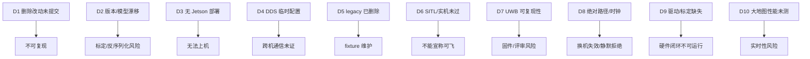

# 架构问题清单与影响证据

> **路径约定**：仓库级路径写作 `src/px4_powerplant_mission/...` 或 `src/px4_powerplant_mission_cpp/...`；包内短路径 `config/…`、`launch/…`、`nodes/…` 相对于 `src/px4_powerplant_mission/`，`src/…`、`include/…`、`test/…`、`scripts/…` 相对于 `src/px4_powerplant_mission_cpp/`；`UWB/…`、`Host/…` 相对于 `C:\Users\pawn-\UWB-loaclization\`；`Tools/simulation/gz/…`、`ROMFS/…` 相对于 `/home/pawn/drone-simulation/`。

> 证据基线：2026-10-26 工作树。本文只记录**已观察到的结构性问题**，不把“功能未完成”一律算作架构债务。  
> 标签：`[事实]` / `[推断]` / `[建议]` / `[待核实]`。  
> 相关文档：[总览](README.md) · [仓库映射](repository-map.md) · [运行模式](runtime-modes.md) · [模块目录](module-catalog.md) · [依赖图](dependency-map.md)

## 1. 方法与严重度

- 证据来源：`git status/log/diff/submodule`、`package.xml`/`CMakeLists.txt`/`setup.py`、launch/YAML、源码、本机测试结果、最新 SITL 报告。
- 没有执行构建、烧录、飞行、提交或网络访问；没有修改业务代码。
- 严重度：

| 级别 | 定义 |
|---|---|
| **S1 阻断** | 无法复现、无法部署、或可能导致错误飞行/数据失效 |
| **S2 高** | 显著增加误配置/回归/排障成本，当前阶段应尽快处理 |
| **S3 中** | 影响可维护性/性能/协作，可在下一阶段处理 |
| **S4 低** | 卫生、文档、体量问题 |

## 2. 总览

| ID | 严重度 | 问题 | 直接影响 | 证据 |
|---|---|---|---|---|
| D1 | **S2** | 本次 Python legacy 删除改动未提交 | 干净检出仍是删除前版本；fixture/入口变更无法复现 | `git status` 的删除/修改/`?? fixtures` |
| D2 | **S1** | PX4/Gazebo/消息版本靠人工同步 | `FailsafeFlags` 字段漂移；雷达偏移/世界依赖未提交修改 | `px4_msgs` vs PX4；gz `M model.sdf` |
| D3 | **S1** | Jetson/实机部署路径缺失 | 无法回答“上机怎么启动/回滚/监控” | 无 aarch64/Docker/systemd；`.p0_deps` 仅 amd64 |
| D4 | **S1** | DDS 依赖本机 Cyclone+LOCALHOST 临时配置 | 跨机/Windows Host/Jetson 通信未证明 | `src/px4_powerplant_mission_cpp/P0_VALIDATION.md:62-78` |
| D5 | **已关闭** | Python legacy 已删除 | 双栈/回退风险关闭；新增 fixture oracle 维护责任 | 删除文件/入口；`test/fixtures/` |
| D6 | **S1** | 完整 SITL/实机验收未通过 | 不能宣称可飞/可交付 | `src/px4_powerplant_mission_cpp/ISSUE3_VALIDATION.md:3`；`TAKEOFF_RESPONSE_SYNC.md:106-112` |
| D7 | **S2** | UWB 工作区可复现性差 | 152 项 EOL 噪声；SDK 无 `.gitmodules`；无实板验证 | `git diff --ignore-cr-at-eol`；SDK gitlink |
| D8 | **S2** | 绝对路径 + 双时间域 | 换机/换用户失效；静默拒绝 UWB | `yolo_python`、照片目录、`px4_timestamp_domain` |
| D9 | **S1** | 真实传感器驱动/标定缺失 | 硬件建图/控制不可直接运行 | `src/` 仅 4 个 `package.xml`；`src/px4_powerplant_mission/config/p2_hardware.yaml:1-10` |
| D10 | **S2** | 大地图/DDS 性能未验收 | 控制周期/健康超时风险 | `src/px4_powerplant_mission/config/powerplant.yaml:150`；`src/px4_powerplant_mission_cpp/MIGRATION_STATUS.md:66` |
| D11 | **S3** | CI 与仓库卫生仍需维护 | 回归依赖 CI 配置；仓库膨胀 | `.github/workflows/` 已存在；18 个 tracked `.pyc` 已删除；7.6 GB build |
| D12 | **S3** | 文档/可观测性漂移 | 决策者高估成熟度；排障慢 | `src/px4_powerplant_mission/README.md`（413 行）；`src/px4_powerplant_mission_cpp/MIGRATION_STATUS.md:20-32` |

## 3. 详细条目

### D1 本次删除改动未提交

**事实**

- 删除前仓库为 `9931daf7` 且工作树干净。
- 删除完成后工作树包含：Python legacy 源码/测试的删除、`setup.py`/launch/CI/README 修改，以及 `test/fixtures/` 新增文件。
- 尚未提交；干净检出仍是删除前版本。

**影响**

- `[推断]` 在提交前，删除结果、fixture 和测试迁移无法从仓库历史复现。
- `[事实]` 若现在切回 HEAD，Python legacy 和新 fixture 都不会同时存在，测试/文档状态不一致。

**建议**

1. 将删除、fixture、测试迁移和文档作为一个可构建提交。
2. 在干净 clone 上重跑 C++/Python 测试与 `run_p0_baseline.sh`。
3. 在提交信息中注明 Q9=A 已被用户明确豁免，避免把删除误读为飞行验收。

**置信度**：事实。

---

### D2 跨仓库版本与模型偏移漂移

**事实：PX4 消息**

- `px4_msgs` 固定在 `7abb737`（2026-05-11，“Update to PX4 48ea8ee…”），版本 2.0.1。
- 本地 `drone-simulation` HEAD `d0a0e3cc3c`（2026-05-17），上游基点 `89806574`（2026-04-29）；本地不包含 `48ea8ee` 对象（`git cat-file` 失败，仓库非 shallow）。
- 246 个消息中 242 个逐字节相同；差异包括：
  - `FailsafeFlags`：`px4_msgs` 多 `bool gnss_lost`（`src/px4_msgs/msg/FailsafeFlags.msg:64`），本地 PX4 无该字段；
  - `AuxGlobalPosition`：`px4_msgs` 多 `SOURCE_LEO`（`src/px4_msgs/msg/AuxGlobalPosition.msg:20`），本地 PX4 无；
  - `BatteryStatus`/`OrbitStatus` 仅注释差异。
- 控制器订阅 `/fmu/out/failsafe_flags`（`src/px4_powerplant_mission_cpp/src/offboard_subscriptions_vehicle.cpp:14-15`），并在 preflight 读取字段（`src/px4_powerplant_mission_cpp/src/offboard_control.cpp:147-155`）。
- `/fmu/out/failsafe_flags` 在 PX4 DDS 默认桥接中（`drone-simulation/src/modules/uxrce_dds_client/dds_topics.yaml:31`），未版本化。

**事实：Gazebo 模型**

- gz 子模块实际是 `pawn-queen/PX4-gazebo-models` 的 `powerplant-sim` 分支（`2dda48c`），但 `drone-simulation/.gitmodules:75-78` 声明 PX4 上游 `main`。
- 唯一未提交修改：`Tools/simulation/gz/models/x500_depth/model.sdf:17` 从 `0 0 0.32` 改为 `0 0 0.18`（雷达下移 14 cm）。
- `x500_base/model.sdf:4` 的 `base_link` 在模型原点上方 0.24 m；`0.24 + 0.18 = 0.42`，与 `config/p2_simulation.yaml:8` 的 `lidar_translation_flu: [0.0, 0.0, 0.42]` 一致；提交版 `0.32` 会得到 0.56。
- 手工仿真用 `drone-simulation/Tools/simulation/gz/worlds/powerplant.sdf`；P2 用主工作区 `test/worlds/p2_<scenario>.sdf`（`src/px4_powerplant_mission_cpp/scripts/run_p2_sitl.py:258`），两者 world name 都是 `powerplant`，内容/模型不同。

**影响**

- `[推断]` `FailsafeFlags` 的字段集不一致可能导致反序列化/字段缺失；由于控制器实际读取该消息，属于**飞行前检查链**风险，不是纯诊断问题。实际是否报错取决于 ROS/DDS 的反序列化实现，`[待核实]`。
- `[事实]` 按当前 gitlink 干净检出会得到 0.32 的雷达；`git submodule update --remote` 则可能直接失去 `powerplant` world/雷达，建图外参与 P2 配置不匹配。`[推断]` 表现为地图整体偏移/障碍误判，而不一定报错。
- `[事实]` 两套 world 文件同名，排障时容易看错世界。

**建议**

1. 在 `.gitmodules` 中明确 fork URL + `powerplant-sim` 分支，或改为固定 SHA 的 vendored 模型；不要用 `--remote`。
2. 提交雷达 0.18 偏移，或在 P2 配置中改为从 SDF 读取并校验；在 CI 中跑 `gz sdf -p` 对比 `p2_simulation.yaml`。
3. 对 `FailsafeFlags`/`AuxGlobalPosition` 做一次真实 PX4 的收发测试；在 `px4_msgs` 与 PX4 之间建立版本矩阵。
4. 明确“手工 world”与“P2 测试 world”的用途，避免同名混淆。

**置信度**：版本/字段/偏移为事实；运行时后果为推断/待核实。

---

### D3 Jetson 实机部署路径缺失

**事实**

- `px4_ros_ws`、`UWB-loaclization` 中没有 Jetson/aarch64/arm64/Orin 业务代码或文档。
- 没有 `Dockerfile`、`*.service`、`docker-compose*`、`setup.sh`/`install.sh`。
- `config/p0_ros_dependencies.json:2` 仅 `ubuntu-noble-amd64`；`src/px4_powerplant_mission_cpp/scripts/bootstrap_p0_ros.py:24-26` 对非 noble/非 x86_64 直接报错。
- `src/px4_powerplant_mission/launch/powerplant_system.launch.py:69` 的 `yolo_python`、`src/px4_powerplant_mission/config/powerplant.yaml:363` 的 `inspection_photo_dir`、`src/px4_powerplant_mission_cpp/scripts/run_p2_sitl.py:106` 的 PX4 根目录都是绝对路径。
- `drone-simulation/build/px4_sitl_default/rootfs/gz_env.sh` 也硬编码 `/home/pawn/drone-simulation`。

**影响**

- `[推断]` 仓库不能回答：Jetson 上装什么 OS/ROS、怎么编 ARM64、怎么托管、怎么开机自启、怎么回滚。
- `[推断]` 直接复制 WSL 环境（amd64 的 `.p0_deps`、绝对路径、localhost DDS）到 Jetson 会失败或行为不同。
- `[待核实]` Jetson 的 ROS 2 Jazzy 可用性、`cv_bridge`/OpenCV/Eigen/JsonCpp 包、GPU/YOLO 时延均无证据。

**建议**

1. 先确定目标 Jetson 型号、JetPack/Ubuntu、ROS 2 版本；形成最小镜像/容器。
2. 在目标机原生构建/运行两个业务包，验证 Agent/PX4 DDS、UWB 串口、相机/雷达。
3. 用 systemd 或容器管理启动顺序、日志、重启和回滚。
4. 把所有绝对路径改为 launch 参数/env/配置文件，并在 CI 中跑一次非 `/home/pawn` 路径的启动检查。

**置信度**：缺失为事实；具体失败模式为推断。

---

### D4 DDS 通信依赖本机临时配置

**事实**

- `src/px4_powerplant_mission_cpp/P0_VALIDATION.md:64-78` 记录：当前主机默认 Fast DDS 同机进程出现单向发现、无数据/服务响应；回环 UDP/显式 locator/TCP 对照未恢复，根因未确定。
- 采用 `RMW_IMPLEMENTATION=rmw_cyclonedds_cpp` + `ROS_AUTOMATIC_DISCOVERY_RANGE=LOCALHOST` 后同机跨进程恢复（`scripts/p0_ros_env.sh:12-13`）。
- 该配置只影响当前 shell；文档明确“不验证 Windows Host、跨计算机 DDS、Agent/PX4 与 Cyclone 的完整互通”（`src/px4_powerplant_mission_cpp/P0_VALIDATION.md:78`）。
- UWB Host 的 README 也记录：本机 WSL Fast DDS 跨进程最小复现失败，ROS 测试仅同进程（`Host/README.md:111`）。

**影响**

- `[事实]` 当前“跨进程测试通过”只在特定 shell + LOCALHOST 下成立。
- `[推断]` Windows Host ↔ WSL/Jetson、Jetson ↔ 飞控、跨计算机 GCS 的 DDS 发现/传输都未证明；这是实机部署的**一级不确定性**。
- `[推断]` LOCALHOST 配置会限制跨机通信；不能把它当成部署默认值。

**建议**

1. 做 DDS 兼容矩阵：Fast DDS/Cyclone × 同机/跨机 × Windows/WSL/Jetson；记录 QoS、domain、discovery、端口。
2. 为部署提供明确的 `RMW_IMPLEMENTATION`/discovery 配置，而不是临时 shell 脚本。
3. 在 UWB Host 与主工作区之间做一次真实双进程、跨容器/跨机测试。

**置信度**：事实（文档/脚本）；跨目标行为为待核实。

---

### D5 Python legacy 删除

**事实**

- Python `nodes/voxel_mapper_node.py`、`nodes/offboard_mission_node.py`、`mapping/voxel_grid.py`、`path_planning/frontier_3d.py`、`path_planning/grid_astar.py`、`common/initial_scan.py` 已删除。
- `setup.py` 只保留 localization/EV/UWB/YOLO 四个入口；launch 移除了 `mapping_package`/`control_package`。
- C++ 测试改用 `test/fixtures/` 的冻结 oracle；`test_ros_contract.py` 不再 AST 解析 Python 源码，`test_reference_parity.py` 不再 import Python。
- `test/fixtures/` 含 `parameter_defaults.json`、`mapper_case.json`、`ray_cases.json`、`route_cases.json`、`planner_cases.json`。

**影响**

- `[事实]` 双栈/回退风险关闭；不会再出现“误启 Python mapper/controller”。
- `[推断]` 新的风险转为 fixture 与 C++ 行为漂移：fixture 更新必须评审，不能静默改期望值。
- `[事实]` `ros_contract` 仍启动 Python localization/EV；Python 包仍保留，不是“删除整个 Python 包”。

**建议**

1. 在 CI 中固定运行 C++ fixture 测试；fixture 变更单独提交并说明来源。
2. 不再新增 `mapping_package`/`control_package` 回退。
3. 保持 `test_ros_contract` 对 Python 定位/EV 的跨进程覆盖。

**置信度**：事实；fixture 漂移为推断。

---

### D6 完整 SITL 与实机验收缺口

**事实**

- 最新完整 SITL 报告：`log/p2_sitl_cpu_17/report.json`，`passed=false`，`exit_reason=mission_fault`；阶段 `IDLE→START→SAFE_TAKEOFF→FAULT`；失败项包括 `all_required_phases`、`phase_order`、`landed_and_disarmed_completion`、`no_mission_fault`、`topology_built`、`inspection_result_explicit`、`actual_photo_and_surface_evidence`。
- `events.jsonl`：`safety_stop` / `mission_fault` 原因为 `MOTION_TRACKING_ERROR_EXCEEDS_CERTIFICATE`。
- 文档记录：原始渲染负载未通过健康启动；CPU 10 Hz 仍慢于实时；2.5 Hz CPU 档接近实时但完整流程未通过（`src/px4_powerplant_mission_cpp/MIGRATION_STATUS.md:32`）。
- 单元/契约测试：删除 legacy 后本机 C++ 400 项、Python 72 项均 0 失败；这不等于飞行验收。
- 实机：Host 仅假串口/PTY/mock；主工作区没有真实传感器驱动；无实飞记录（`Host/README.md:102-111`；`src/px4_powerplant_mission_cpp/P0_VALIDATION.md:78`）。

**影响**

- `[事实]` 当前不能宣称“完整仿真通过”或“可实机飞行”。
- `[推断]` 运动证书/跟踪门限与 PX4 起飞响应仍未对齐；这类问题通常不是单元测试能覆盖的。
- `[推断]` 决策者若只看测试数量，会高估成熟度。

**建议**

1. 把“单元/契约通过”和“SITL 通过”“实机通过”分成三个独立状态，在 README 顶部固定展示。
2. 先解决最新 SITL 的 tracking/certificate 失败，再谈原始传感器负载和性能。
3. 实机按“单 Anchor—Tag 已知距离 → 四锚 → Host→EV→PX4 → 建图 → 控制”分级验收。

**置信度**：事实。

---

### D7 UWB 工作区可复现性

**事实**

- 根仓库 `git status` 152 项，但 `git diff --stat --ignore-cr-at-eol` 内容差异为 0：全部 CRLF↔LF；没有 `.gitattributes`，`core.autocrlf` 未设置。
- 嵌套 `STM32F103-BU0x_SDK` 是 gitlink（`160000 1a0ce6c`），但仓库**没有 `.gitmodules`**；`git submodule status` 报 `fatal: no submodule mapping found in .gitmodules`。
- SDK 147 个脏项中 9 个为真实 Keil/IDE 改动（`Projects/USER/Output/*`、`Listing/*.lst`、`Project.uvoptx`、`Project.uvprojx`、`RTE/_Project/RTE_Components.h`），包括本地删除的 `Output/Project.axf`。
- 固件默认 RANGE v1（`uwb_service.cpp:496`），Host 只接受 v2（`processing.py:153`）；需要每块板 `AT+RANGEVER=2`。
- 无实板验证；Host 测试仅假串口/PTY/同进程 ROS。

**影响**

- `[事实]` 新 clone 无法取得厂家 SDK；`UWB/` 的 GCC 构建使用自身 `Boards/` 与 `Middleware/`（`UWB/CMakeLists.txt:24-40`）。`[推断]` SDK 缺失主要影响厂家 Keil 工程/参考与完整溯源，不必然阻断当前 GCC 构建；`[待核实]` 需在干净 clone 上验证。
- `[推断]` 152 项 EOL 噪声会掩盖真实改动；评审/提交容易误伤。
- `[事实]` 未刷 v2/未握手的板会被 Host 持续拒绝，表现为“串口有数据但无位姿”。

**建议**

1. 加 `.gitattributes`（`* text=auto` 或按扩展名），统一换行；把 SDK 改为正式 submodule 或 vendored 目录。
2. 清理/忽略 Keil 输出；保留厂家源码基线。
3. 在 Host 启动日志中显式打印固件 `range_version` 与握手结果；部署清单要求统一刷写。
4. 增加一次实板串口记录作为验收证据。

**置信度**：缺 SDK/换行噪声为事实；对构建的影响为待核实。

---

### D8 绝对路径与双时间域耦合

**事实**

- 绝对路径：`yolo_python=/home/pawn/px4_ros_ws/.venv/bin/python`（`src/px4_powerplant_mission/launch/powerplant_system.launch.py:69`）、`inspection_photo_dir=/home/pawn/px4_ros_ws/inspection_photos`（`src/px4_powerplant_mission/config/powerplant.yaml:363`）、`--px4-root` 默认 `/home/pawn/drone-simulation`（`src/px4_powerplant_mission_cpp/scripts/run_p2_sitl.py:106`）、`gz_env.sh` 硬编码（drone 报告）。
- 时间域：仿真 `use_sim_time=true` + `/clock`；实机 `use_sim_time=false` + 系统时钟；P2 锁步把 `px4_timestamp_domain` 改为 `ros`、`UXRCE_DDS_SYNCT=0`（`src/px4_powerplant_mission_cpp/scripts/run_p2_sitl.py:276-279,300`）；实机默认 `system`（`src/px4_powerplant_mission/config/powerplant.yaml:14`；`src/px4_powerplant_mission/LOCALIZATION_DEPLOYMENT.md:82-84`）。
- UWB Host 使用测量 UTC 时间；EV 在仿真中把 ROS 样本年龄映射到系统通信时钟（`src/px4_powerplant_mission/LOCALIZATION_DEPLOYMENT.md:84`）。

**影响**

- `[事实]` 换用户、换机器、Jetson 或不以 `/home/pawn` 为根时，YOLO/照片/PX4 路径失效。
- `[推断]` 时钟域配错时，节点仍会启动，但 UWB 样本被判过期/EV 不融合；这是“静默失败”，比崩溃更难排。
- `[事实]` 仿真与实机的时钟配置不同，不能直接复制 launch 参数。

**建议**

1. 所有路径改为 launch 参数/env/`ament_index` 解析，提供默认值但允许覆盖。
2. 在启动日志/`mission_status` 中打印实际 `use_sim_time`、`px4_timestamp_domain`、时钟源。
3. 把时间域契约写成测试：仿真/实机各一组，验证过期/超前/时钟回退。

**置信度**：事实；静默失败为推断。

---

### D9 真实传感器驱动与标定缺失

**事实**

- `src/` 下只有 4 个 `package.xml`：两个业务包 + `px4_msgs` + `px4_ros_com`；没有相机/深度/雷达驱动包。
- 硬件 profile 仍默认 `use_mapping=true`（`src/px4_powerplant_mission/launch/powerplant_system.launch.py:56`），建图订阅 `/depth_camera`、`/mapping_lidar`、`/points`（`src/px4_powerplant_mission/config/powerplant.yaml:105-108`），但仓库不提供这些话题的真实生产者。
- `config/p2_hardware.yaml:1-10`：`motion_model_configured=false`，bootstrap 高度/时长 0；`src/px4_powerplant_mission/config/powerplant.yaml:275-280`：`takeoff_region_confirmed=false`、高度 0。
- 硬件相机的 `camera_translation_flu`/`lidar_translation_flu` 在共享配置里是仿真/示例值（`src/px4_powerplant_mission/config/powerplant.yaml:146-148`），P2 才用 SDF 值覆盖（`src/px4_powerplant_mission/config/p2_simulation.yaml:4-9`）。

**影响**

- `[事实]` 按当前仓库直接 `localization_profile:=hardware` 启完整 launch，建图没有真实输入；控制会因起飞区/运动模型未确认而拒绝或进入等待。
- `[推断]` 若为了“先跑起来”复制 SITL 外参/确认值，会带来碰撞/定位风险。
- `[待核实]` 真实相机/雷达型号、驱动、时间同步、外参都没有记录。

**建议**

1. 为真实传感器建立独立驱动包/launch，统一发布与仿真同名的话题。
2. 提供 `hardware.yaml`/`motion.yaml` 的实测模板和校验（外参、包络、制动、时延）。
3. 硬件首飞前强制 `takeoff_region_confirmed`、`motion_model_configured`、相机/雷达标定检查，不要用默认值绕过。

**置信度**：事实；风险为推断。

---

### D10 大地图/DDS 性能未验收

**事实**

- 地图以 2 Hz 发布完整 `observed_voxels`，上限 `max_publish_points=200000`（`src/px4_powerplant_mission/config/powerplant.yaml:150`；`src/px4_powerplant_mission/README.md:174`）。
- 控制节点使用点云时间戳与 `fusion_status.map_stamp_ns` 精确配对，只接受完整、健康、指纹一致快照（`src/px4_powerplant_mission/README.md:174`；`src/px4_powerplant_mission_cpp/P0_VALIDATION.md:11`）。
- `src/px4_powerplant_mission_cpp/MIGRATION_STATUS.md:66` 明确：未完成大型地图/YOLO 并行负载下的尾延迟测量；`:172` 也说未测量大型地图控制周期延迟。
- 控制主循环 10 Hz（`offboard_node.cpp:113`），运动流 50 Hz（`motion_runtime`），地图 2 Hz。

**影响**

- `[推断]` 大地图时，完整点云序列化/传输/解析可能挤占控制周期；`max_publish_points` 超限会停止新探索，但不会自动降低地图频率。
- `[事实]` 可靠 QoS + 大消息对 DDS 缓冲/内存有压力；当前没有目标机实测。
- `[推断]` Jetson 上 CPU/网络更紧张，风险更高。

**建议**

1. 在目标机用 20k/100k/200k 点云做端到端延迟/CPU/内存基准，记录 p95/p99。
2. 评估控制关键地图与可视化的分离（控制只订阅增量/局部，不订阅完整云）。
3. 明确超限行为（停止探索 vs 降采样）并在状态中报告。

**置信度**：事实（未测）；性能后果为推断。

---

### D11 CI 与仓库卫生

**事实**

- `.github/workflows/` 已存在；完整 SITL 仍由 `run_p2_sitl.py` 人工触发。
- 18 个 tracked `.pyc` 已随本次删除移除；`.gitignore` 已有 `__pycache__/`。
- `px4_ros_com` 已安装但业务包未引用；`src/px4_msgs`、`src/px4_ros_com` 同时被 `.gitignore` 和 `.gitmodules` 管理。
- `drone-simulation` 的 `build/` 7.6 GB 未跟踪；`UWB/build` 94 MB；gz 子模块有 30 MB STL 和 Windows `:Zone.Identifier` 文件；未发现 Git LFS 配置。
- `drone-simulation` 的构建版本宏 `v1.17.0-alpha1-1643-g31136c9043` 落后 HEAD 的 1645。

**影响**

- `[推断]` 回归依赖人工执行，跨提交/跨机器容易漏测。
- `[事实]` tracked `.pyc` 曾随源码产生无意义 diff；本次已清理。
- `[事实]` 大二进制/构建产物增加 clone/备份成本；`Zone.Identifier` 是无意义元数据。
- `[推断]` 版本宏滞后会让“二进制对应哪个源码”变得不可信。

**建议**

1. 保持 CI：干净 clone → 子模块 → 构建 → C++/Python/契约测试；至少 nightly 跑 SITL 准备检查。
2. 移除 tracked `.pyc`，加 `__pycache__/` 检查；用 `git lfs` 管理大模型/网格，或明确不入库。
3. 修复 `.gitmodules`/`.gitignore` 冲突；`px4_ros_com` 若不用则移出构建。
4. 重新构建 PX4 或清理 build，确保版本宏与 HEAD 一致。

**置信度**：事实；影响为推断。

---

### D12 文档/可观测性漂移

**事实**

- `src/px4_powerplant_mission/README.md` 413 行，混合当前行为、历史排查、验证步骤、参数说明；`src/px4_powerplant_mission_cpp/MIGRATION_STATUS.md` 记录 300 个直接用例，但最新 SITL 仍失败。
- 运行状态分散在 `mission_status`、`fusion_status`、`localization/status`、UWB quality、事件 JSON、日志/报告中，没有统一健康面板。
- 关键契约是字符串 JSON（定位/地图/UWB），没有 schema 文件；字段变更靠文档/测试。
- `src/px4_powerplant_mission_cpp/P2_VALIDATION.md` 明确“prepare-only 的 `passed=false` 不代表验收”；但普通读者容易把测试数量当成飞行能力。

**影响**

- `[推断]` 决策者/新成员需要读多份长文档才能判断“现在能不能飞”。
- `[事实]` 失败原因（如 `MOTION_TRACKING_ERROR_EXCEEDS_CERTIFICATE`）只在事件/报告里，不在顶层状态摘要。
- `[推断]` 字符串契约漂移时，排障需要跨仓库读代码。

**建议**

1. 增加一页“当前状态”看板：构建、单元、SITL、实机、已知失败，绑定提交 SHA。
2. 为 JSON 契约补 schema/版本字段；在 `mission_status` 顶层加 `health_summary`。
3. 把历史排查/研究移到单独文档，README 只保留当前运行手册。

**置信度**：事实；影响为推断。

## 4. 优先级路线（建议，不修改代码）

| 阶段 | 动作 | 对应债务 |
|---|---|---|
| **P0（本周）** | 提交本次 Python legacy 删除/fixture/测试迁移；修复 `.gitmodules`/`.gitattributes`；提交/回退 gz 雷达偏移；在干净 clone 重跑构建与 SITL | D1、D2、D7、D11 |
| **P0（本周）** | 确定 Jetson 目标环境；在目标机验证 DDS/UWB 串口/Agent 最小链路 | D3、D4、D8 |
| **P1（下一阶段）** | 解决 SITL tracking/certificate 失败；建立“单元/SITL/实机”三态看板 | D6、D12 |
| **P1** | 真实传感器驱动 + 标定模板；硬件首飞检查表 | D9 |
| **P2** | 大地图/DDS 性能基准；fixture/CI 维护；LFS | D5、D10、D11 |

## 5. 接受为设计约束、暂不算债务

- `[事实]` 单 UWB Tag 不提供姿态/速度，EV 用 `NaN` 表示未知（`external_vision_bridge_node.py:81-105`）。这是物理约束，不是缺陷。
- `[事实]` `auto_start=false`、`use_control=false` 是安全默认（`src/px4_powerplant_mission/config/powerplant.yaml:261`；`src/px4_powerplant_mission/launch/powerplant_system.launch.py:62`）。
- `[事实]` 完整 PX4 fork 放在 `drone-simulation` 是仿真需要；8.8 GB 本身不是架构问题，未跟踪的 7.6 GB `build/` 才是卫生问题。
- `[事实]` WSL 上串行编译/测试是资源约束下的合理选择（`src/px4_powerplant_mission/README.md:32-42`；`CMakeLists.txt:110` 的 `RUN_SERIAL`）。
