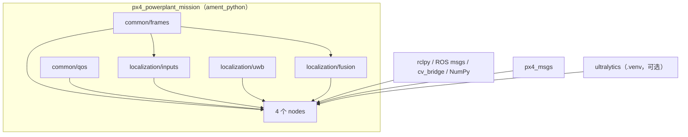
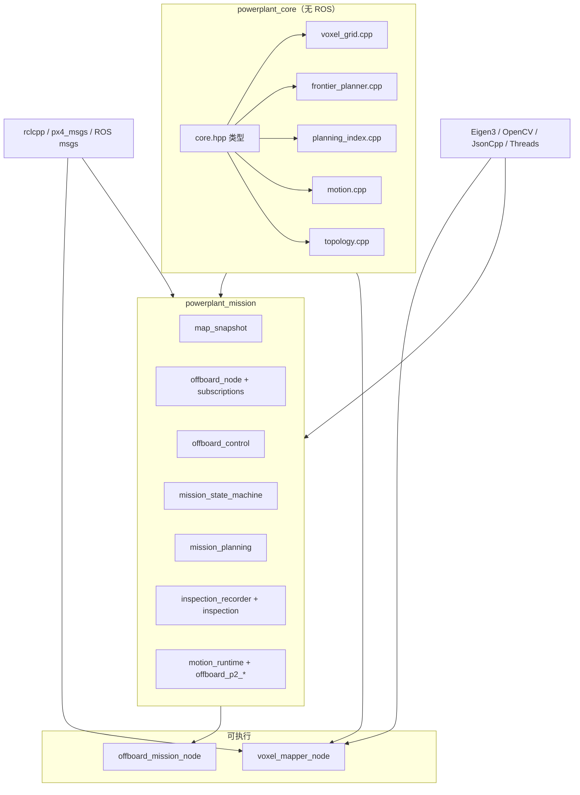
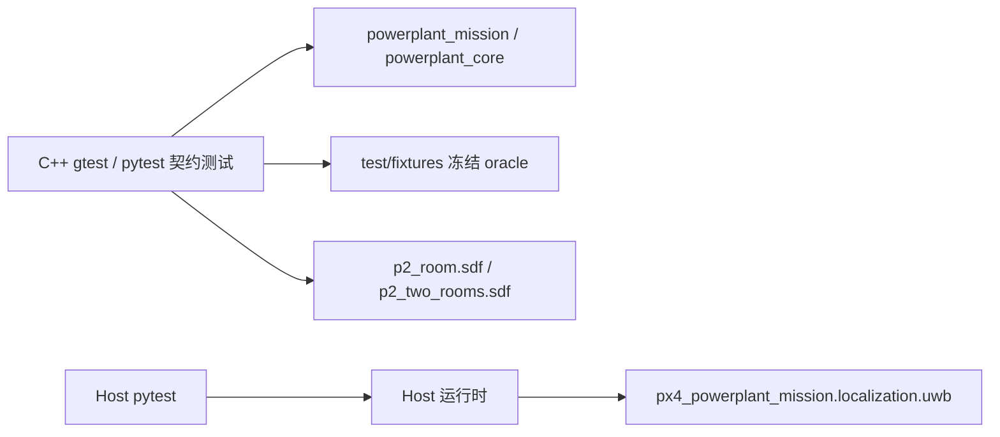

# 依赖方向与接口关系

> **2026-10-30 更新**：Python mapper/controller 已删除；`mapping_package`/`control_package` 已移除，建图/控制固定为 C++。本文中“Python 回退/双栈”段落是删除前历史。

> **路径约定**：仓库级路径写作 `src/px4_powerplant_mission/...` 或 `src/px4_powerplant_mission_cpp/...`；包内短路径 `config/…`、`launch/…`、`nodes/…` 相对于 `src/px4_powerplant_mission/`，`src/…`、`include/…`、`test/…`、`scripts/…` 相对于 `src/px4_powerplant_mission_cpp/`；`UWB/…`、`Host/…` 相对于 `C:\Users\pawn-\UWB-loaclization\`；`Tools/simulation/gz/…`、`ROMFS/…` 相对于 `/home/pawn/drone-simulation/`。

> 证据基线：2026-10-26 工作树。本文把依赖分成**构建期**、**运行期**、**测试期**和**部署期**，避免把“package.xml 声明”“import”“DDS 话题”混为一谈。  
> 标签：`[事实]` / `[推断]` / `[建议]` / `[待核实]`。  
> 相关文档：[总览](README.md) · [仓库映射](repository-map.md) · [运行模式](runtime-modes.md) · [模块目录](module-catalog.md) · [架构债务](architecture-debt.md)

## 1. 依赖分层

| 层 | 依赖 | 方向 | 证据 |
|---|---|---|---|
| 构建期（Python） | `ament_python`、`setuptools`、ROS 消息包、`cv_bridge`、NumPy；YOLO 依赖单列 | 包 → ROS/系统库 | `px4_powerplant_mission/package.xml:10-31`；`requirements-yolo.txt` |
| 构建期（C++） | `ament_cmake`、rclcpp、px4_msgs、ROS 消息、cv_bridge、OpenCV、Eigen3、JsonCpp、Threads | 包 → ROS/系统库 | `CMakeLists.txt:8-21` |
| 构建期（UWB Host） | `ament_python`、rclpy、geometry_msgs、std_msgs、std_srvs、PyYAML、pyserial、NumPy | 包 → ROS/Python 库 | `Host/package.xml:2-19` |
| 运行期（ROS） | `/fmu/*`、`/uwb/*`、`/powerplant/*`、`/clock` | 节点 ↔ DDS | 见第 3 节 |
| 运行期（跨仓库） | Host → `px4_powerplant_mission.localization.uwb` | Python import | `Host/uwb_hardware_bridge/solver.py:12` |
| 运行期（仿真） | PX4 → Gazebo world/models；Gazebo → ROS bridge | 进程/文件 | `Tools/simulation/gz/worlds/powerplant.sdf`；`src/px4_powerplant_mission_cpp/scripts/run_p2_sitl.py:319-329` |
| 测试期 | C++ 测试 → Python 参考实现；Host 测试 → 主工作区解算器 | 反向/跨仓库 | `CMakeLists.txt:98-109`；`Host/README.md:95-100` |
| 部署期 | 三个工作空间 + Agent + PX4 + 真实传感器 | 人工编排 | `src/px4_powerplant_mission/README.md:65-86`；`src/px4_powerplant_mission_cpp/P2_VALIDATION.md:29` |

## 2. 构建/链接依赖

### 2.1 Python 包

`[事实]` 包内模块没有循环 import；`nodes/*.py` 只依赖 `common/`、`localization/`。`[事实]` Python 包不 import C++ 包；`package.xml` 的 `exec_depend px4_powerplant_mission_cpp` 表示组合 launch 仍需要 C++ 包。

### 2.2 C++ 库

`[事实]` `powerplant_core` 只链接 Eigen（`CMakeLists.txt:23-25`），是 ROS 无关的纯算法层；`powerplant_mission` 链接 ROS 消息、`powerplant_core`、JsonCpp、OpenCV、Threads（`:26-29`）。`[推断]` 这个分层使算法可单测，但 `powerplant_mission` 把控制器、地图消费、巡检、运动运行时放在一个库里，边界仍然偏粗。

### 2.3 测试期反向依赖

`[事实]` `reference_parity` 现在读取 `test/fixtures`，不再 import Python legacy；`ros_contract` 仍启动 Python localization/EV 节点，并设置 `ROS_DOMAIN_ID=173`。Host 测试通过 `PYTHONPATH:.:/home/pawn/px4_ros_ws/src/px4_powerplant_mission` 复用解算器（`Host/README.md:95-100`）。`[推断]` 跨仓库测试仍依赖主工作区源码/install。

## 3. 运行期 ROS 接口

### 3.1 话题（按数据流方向）

| 生产者 | 话题 | 类型 | 消费者 | QoS/备注 | 证据 |
|---|---|---|---|---|---|
| Gazebo bridge | `/clock` | `rosgraph_msgs/Clock` | 仿真所有节点 | `use_sim_time` | `src/px4_powerplant_mission/launch/powerplant_system.launch.py:90-101` |
| Gazebo bridge | `/world/powerplant/dynamic_pose/info` | `tf2_msgs/TFMessage` | UWB 仿真器 | Gazebo 真值 | `:102-116` |
| Gazebo bridge | `/model/x500_depth/odometry_with_covariance` | `nav_msgs/Odometry` | UWB 仿真器 | 后备真值 | 同上 |
| Gazebo/真实驱动 | `/depth_camera`、`/depth_camera/camera_info` | `sensor_msgs/Image`、`CameraInfo` | mapper、controller | 传感器 QoS | `src/px4_powerplant_mission/config/powerplant.yaml:6,106`；`src/px4_powerplant_mission/launch/gz_sensor_bridge.launch.py:45-52` |
| Gazebo/真实驱动 | `/camera`、`/camera/camera_info` | `Image`、`CameraInfo` | YOLO、controller | 传感器 QoS | 同上 `:47-54` |
| Gazebo/真实驱动 | `/mapping_lidar` | `sensor_msgs/LaserScan` | mapper、controller | 传感器 QoS | `src/px4_powerplant_mission/launch/gz_sensor_bridge.launch.py:49,55` |
| Gazebo/真实驱动 | `/points` | `sensor_msgs/PointCloud2` | mapper | 可选 | `src/px4_powerplant_mission/config/powerplant.yaml:108` |
| UWB 仿真器 | `/uwb/pose` | `PoseWithCovarianceStamped` | localization、EV | reliable | `uwb_simulator_node.py:53-57` |
| UWB 仿真器 | `/uwb/quality` | `std_msgs/String` JSON | localization、EV | reliable | `:58-62` |
| UWB 仿真器 | `/uwb/range/<anchor>` | `sensor_msgs/Range` | 诊断（无业务订阅） | reliable | `:68-75` |
| UWB 仿真器 | `/uwb/anchors` | `MarkerArray` | RViz | reliable | `:63-67` |
| UWB Host | `/uwb/hardware/pose` | `PoseWithCovarianceStamped` | localization、EV（硬件 profile） | reliable/volatile/depth 10 | `Host/uwb_hardware_bridge/ros_node.py:79-95` |
| UWB Host | `/uwb/hardware/quality`、`/status` | `String` JSON | localization、EV | reliable | 同上 |
| UWB Host | `/uwb/hardware/observations` | `String` JSON | 诊断（无业务订阅） | reliable | `Host/uwb_hardware_bridge/ros_node.py:81,94` |
| PX4 | `/fmu/out/vehicle_odometry` | `px4_msgs/VehicleOdometry` | localization | PX4 QoS | `localization_node.py:115-120` |
| PX4 | `/fmu/out/vehicle_local_position` | `VehicleLocalPosition` | localization、UWB 仿真器 | PX4 QoS | `:109-114`；`uwb_simulator_node.py:77-82` |
| PX4 | `/fmu/out/vehicle_imu` | `VehicleImu` | localization（adaptive 用） | PX4 QoS | `:103-108` |
| localization | `/powerplant/localization/odom` | `nav_msgs/Odometry` | mapper、controller、RViz | reliable | `localization_node.py:93-95` |
| localization | `/powerplant/localization/pose` | `PoseStamped` | 诊断 | reliable | `:96-98` |
| localization | `/powerplant/localization/status` | `String` JSON | mapper、controller | reliable | `:99-101` |
| localization | `/tf` | `tf2_msgs/TFMessage` | RViz/其他消费者 | `map`→`base_link`，`publish_tf=true` | `localization_node.py:516-525` |
| EV | `/fmu/in/vehicle_visual_odometry` | `px4_msgs/VehicleOdometry` | PX4 EKF | PX4 QoS | `external_vision_bridge_node.py:32-33` |
| mapper | `/powerplant/map/occupied_voxels`、`/observed_voxels` | `PointCloud2` | controller、RViz | reliable | `voxel_mapper_node.cpp:46-49` |
| mapper | `/powerplant/map/occupancy_grid` | `OccupancyGrid` | controller、RViz | reliable | `:50-51` |
| mapper | `/powerplant/map/voxel_markers` | `MarkerArray` | RViz | reliable | `:52-53` |
| mapper | `/powerplant/map/fusion_status` | `String` JSON | controller | reliable | `:54-55` |
| YOLO | `/powerplant/perception/yolo_detections` | `String` JSON | controller | reliable | `yolo_detector_node.py:34-38` |
| YOLO | `/powerplant/perception/yolo_source_image` | `Image` | controller | sensor | `:39-43` |
| YOLO | `/powerplant/perception/yolo_annotated` | `Image` | RViz/诊断 | sensor | `:44-48` |
| controller | `/powerplant/perception/target_position` | `PointStamped` | 诊断 | reliable | `offboard_node.cpp:72-73` |
| controller | `/powerplant/control/planned_path` | `nav_msgs/Path` | RViz/诊断 | reliable | `:70-71` |
| controller | `/powerplant/control/mission_status` | `String` JSON | 操作者/诊断 | reliable | `:66-67` |
| controller | `/powerplant/control/inspection_events` | `String` JSON | 操作者/诊断 | reliable | `:68-69` |
| controller | `/fmu/in/offboard_control_mode` | `px4_msgs/OffboardControlMode` | PX4 | PX4 QoS | `:60-61` |
| controller | `/fmu/in/trajectory_setpoint` | `px4_msgs/TrajectorySetpoint` | PX4 | PX4 QoS | `:62-63` |
| controller | `/fmu/in/vehicle_command` | `px4_msgs/VehicleCommand` | PX4 | PX4 QoS | `:64-65` |
| PX4 | `/fmu/out/vehicle_status_v4` | `VehicleStatus` | controller | launch 重映射 | `src/px4_powerplant_mission/launch/powerplant_system.launch.py:16-24`；`offboard_subscriptions_vehicle.cpp:9` |
| PX4 | `/fmu/out/vehicle_land_detected` | `VehicleLandDetected` | controller | PX4 QoS | `offboard_subscriptions_vehicle.cpp:10-11` |
| PX4 | `/fmu/out/failsafe_flags` | `FailsafeFlags` | controller | PX4 QoS | `:14-15` |
| PX4 | `/fmu/out/battery_status_v1` | `BatteryStatus` | controller | launch 重映射 | `offboard_subscriptions_map.cpp:20-25` |
| PX4 | `/fmu/out/vehicle_command_ack_v1` | `VehicleCommandAck` | controller | launch 重映射 | `offboard_subscriptions_vehicle.cpp:16` |

`[事实]` 仿真 UWB **没有** `/uwb/status` 发布者：`uwb_simulator_node` 只发布 pose/quality/ranges/anchors（`uwb_simulator_node.py:53-75`），而 `src/px4_powerplant_mission/config/powerplant.yaml:9` 和 localization/EV 都订阅 `/uwb/status`。`[推断]` 仿真路径实际依赖 quality 与超时，而不是显式 status 事件；这是“接口存在但生产者缺失”的隐性契约，排查时应知道。

### 3.2 服务

| 服务 | 类型 | 提供者 | 消费者 | 证据 |
|---|---|---|---|---|
| `/start_powerplant_mission` | `std_srvs/Trigger` | C++ controller | 操作者/测试脚本 | `offboard_node.cpp:102-105` |
| `/land_powerplant_mission` | `std_srvs/Trigger` | C++ controller | 操作者/测试脚本 | `:106-112` |
| `/uwb_hardware_bridge/start` | `std_srvs/Trigger` | Host | 操作者 | `Host/uwb_hardware_bridge/ros_node.py:101` |
| `/uwb_hardware_bridge/stop` | `std_srvs/Trigger` | Host | 操作者 | `:102` |

`[事实]` Host 的 start/stop 是**排队**语义：服务成功只表示命令入队，最终结果在 `/uwb/hardware/status` 的 `command_result`（`Host/README.md:77-79`）。`[推断]` 自动化脚本不能把服务返回当作设备已启动。

### 3.3 内部 JSON/文件契约

| 契约 | 生产者 | 消费者 | 关键字段 | 证据 |
|---|---|---|---|---|
| 定位状态 | localization | mapper、controller | `status_stamp_ns`、`status_sequence`、`localization_epoch`、`uwb_input_healthy`、`has_independent_position`、`position_variance_enu_m2` | `localization_node.py:591-651`；`src/px4_powerplant_mission_cpp/P0_VALIDATION.md:42-47` |
| 地图健康 | mapper | controller | `map_epoch`、`status_sequence`、`localization_healthy`、`pose_last_sample_stamp_ns`、`observed_cloud_fingerprint` | `src/px4_powerplant_mission_cpp/P0_VALIDATION.md:49-58`；`voxel_mapper_node.cpp` 状态发布 |
| UWB 质量 | UWB 仿真器/Host | localization、EV | `sample_stamp_ns`、`accepted`、`used_anchors`、`rejected_anchors`、`residual_rms_m`、`geometry_condition`、`position_variance_m2`；Host 额外 `kind`/`reason`/`confirmed_running` | `uwb_simulator_node.py:380-390`；`Host/uwb_hardware_bridge/ros_node.py:39-53`；`localization/inputs.py:80-118` |
| 地图点云 | mapper | controller | `x,y,z,state` 四字段；`state=0` 空闲、`1` 占据、`-1` 不确定 | `src/px4_powerplant_mission/README.md:174`；`src/px4_powerplant_mission_cpp/P0_VALIDATION.md:11` |
| 任务状态 | controller | 操作者 | `phase`、`nav_target_enu`、`setpoint_enu`、`command_wait_reason`、`initial_scan_*`、`explore_wait_reason` | `src/px4_powerplant_mission/README.md:150-172` |
| 巡检事件 | controller | 操作者 | 目标发现、坐标、拍照、返航、降落 | `src/px4_powerplant_mission/README.md:375` |
| 照片目录 | controller | 文件系统 | `inspection_photo_dir`（绝对路径） | `src/px4_powerplant_mission/config/powerplant.yaml:363` |
| 运动配置 | 操作者 | mapper/controller | 外参、包络、制动/时延、`motion_model_configured` | `src/px4_powerplant_mission/README.md:405-413`；`src/px4_powerplant_mission/config/p2_hardware.yaml:1-10` |
| Host 配置 | 操作者 | Host | 串口、Tag ID、Anchor ENU、`coordinates_measured`、噪声/门限 | `Host/uwb_hardware_bridge/config.py:27-80` |

`[事实]` 地图/定位健康协议是跨进程的**字符串 JSON 契约**，不是 ROS 消息字段；字段缺失/旧版本会被 C++ 控制器拒绝（`src/px4_powerplant_mission_cpp/P0_VALIDATION.md:58`）。`[推断]` 这类契约没有 `.msg`/schema 文件，升级时容易漏改一端。

## 4. 跨仓库版本耦合

| 耦合 | 当前状态 | 风险 | 证据 |
|---|---|---|---|
| `px4_msgs` ↔ 本地 PX4 | `px4_msgs` 7abb737（2026-05-11，PX4 48ea8ee）；本地 PX4 HEAD d0a0e3cc（2026-05-17，基点 89806574）；本地不含 48ea8ee | 关键消息 242/246 一致；`FailsafeFlags` 缺 `gnss_lost`，`AuxGlobalPosition` 缺 `SOURCE_LEO`；控制器订阅 `failsafe_flags` | `px4_msgs/msg/FailsafeFlags.msg:64`；`drone-simulation/msg/FailsafeFlags.msg`（无该行）；`drone-simulation/msg/versioned/AuxGlobalPosition.msg` vs `px4_msgs`；`offboard_subscriptions_vehicle.cpp:14-15` |
| Gazebo 模型 ↔ P2 配置 | 雷达偏移工作树 0.18（未提交）、提交 0.32；`p2_simulation.yaml` 期望 0.42（base_link 0.24 + 0.18） | 干净检出/子模块更新会改变建图输入 | `Tools/simulation/gz/models/x500_depth/model.sdf:17`；`x500_base/model.sdf:4`；`src/px4_powerplant_mission/config/p2_simulation.yaml:6-8` |
| Gazebo 分支 ↔ `.gitmodules` | `.gitmodules` 声明 PX4 上游 `main`；实际检出 fork `powerplant-sim` 的 2dda48c | `git submodule update --remote` 会丢 `powerplant` world/雷达 | `drone-simulation/.gitmodules:75-78`；`git -C Tools/simulation/gz remote -v` |
| Host ↔ 主工作区解算器 | Host 运行时 import `solve_uwb_ranges`；记录源码 SHA-256 | 主工作区升级可能改变 Host 行为；无版本断言 | `Host/uwb_hardware_bridge/solver.py:6-20`；`Host/uwb_hardware_bridge/processing.py:119,241-249` |
| 主工作区 ↔ Gazebo 世界名 | 手工用 `worlds/powerplant.sdf`；P2 用 `test/worlds/p2_*.sdf`，但两者 world name 都是 `powerplant` | 话题 `/world/powerplant/*` 相同；模型/内容不同 | `src/px4_powerplant_mission_cpp/scripts/run_p2_sitl.py:258`；`src/px4_powerplant_mission_cpp/P2_VALIDATION.md:46`；`powerplant.sdf:3` |
| 主工作区 ↔ UWB 话题 | 仿真 `/uwb/pose`、`/uwb/quality`，硬件 `/uwb/hardware/*` | profile 配错会导致无数据但不报错 | `src/px4_powerplant_mission/config/localization_simulation.yaml`；`localization_hardware.yaml` |

`[推断]` 项目没有“版本矩阵”文件；上述耦合靠 README、脚本默认值和人工记忆维持。`[建议]` 至少在 CI/部署清单中加入：`px4_msgs` SHA、PX4 `git describe`、gz 子模块 SHA、Host 解算器 SHA、`gz sdf -p` 的传感器偏移。

## 5. 架构依赖规则（应保持）

| 规则 | 现状 | 证据 |
|---|---|---|
| EV 只能接独立 UWB，不能接导航里程计 | 代码满足：EV 不订阅 `localized_odom_topic` | `external_vision_bridge_node.py:34-38,41`；`src/px4_powerplant_mission/LOCALIZATION_DEPLOYMENT.md:20` |
| 单 Tag 不得伪造姿态/速度 | 代码满足：`q=NaN`、速度 `NaN`、姿态方差 `NaN` | `external_vision_bridge_node.py:81-105` |
| Python legacy 已不能驱动 C++ controller | 源码/入口已删除；只剩 C++ 健康协议 | `src/px4_powerplant_mission_cpp/MIGRATION_STATUS.md` |
| 仿真源不得在硬件 profile 打开 | launch 默认按 profile 关闭 UWB 仿真/真值/时钟桥 | `src/px4_powerplant_mission/launch/powerplant_system.launch.py:52-55` |
| 同一 UWB pose 话题只能有一个发布者 | Host 检测 `count_publishers>1` 并拒绝 | `Host/uwb_hardware_bridge/ros_node.py:133-137` |
| 定位/mapper/控制共享同一 `use_sim_time` | launch 给四个节点传同一参数 | `src/px4_powerplant_mission/launch/powerplant_system.launch.py:78,86,130,148` |

`[推断]` 规则 1/2 是实机安全的关键，但只有单元/契约测试；没有实机故障注入验证（`src/px4_powerplant_mission_cpp/MIGRATION_STATUS.md:92`）。

## 6. 依赖反模式与缺口

| 反模式 | 表现 | 影响 | 证据 |
|---|---|---|---|
| 跨仓库源码 import | Host 直接 import 主工作区包 | 部署必须同时安装/`source` 两个工作区；版本漂移不可见 | `Host/uwb_hardware_bridge/solver.py:12`；`Host/package.xml:18` |
| 冻结 oracle 维护 | C++ `reference_parity` 读 `test/fixtures`；`ros_contract` 仍启动 Python 定位/EV | fixture 与 C++ 行为漂移需评审；Python 只保留运行节点 | `test/test_reference_parity.py`；`test/test_ros_contract.py` |
| 字符串 JSON 契约 | 定位/地图/UWB 质量均为 `String` | 无 schema、无编译期检查；一端字段变更另一端静默拒绝 | `src/px4_powerplant_mission_cpp/P0_VALIDATION.md:42-58`；`localization/inputs.py:80-118` |
| 绝对路径 | YOLO Python、照片目录、P2 PX4 根目录 | 换用户/换机器（Jetson）即失效 | `src/px4_powerplant_mission/launch/powerplant_system.launch.py:69`；`src/px4_powerplant_mission/config/powerplant.yaml:363`；`src/px4_powerplant_mission_cpp/scripts/run_p2_sitl.py:106` |
| 子模块 URL 自引用 | `.gitmodules` 的 `./src/...` | 干净 clone 无法按文档取子模块 | `.gitmodules:1-6`；`.gitignore:12-13` |

## 7. 依赖验收建议

- `[建议]` 增加一个机器可读的“版本矩阵”（YAML/JSON）：`px4_msgs` SHA、PX4 `describe`、gz SHA、Host solver SHA、ROS/Agent 版本；启动时打印/校验。
- `[建议]` 为字符串 JSON 契约补 schema（JSON Schema 或 `.msg`），至少在 CI 中做字段存在性/类型检查。
- `[建议]` 把 Host 解算器依赖改成显式版本协商（`solver_version` 已记录，可扩展为兼容区间），而不是只记录 SHA。
- `[建议]` 在 CI 中跑“干净 clone + 子模块 + 构建 + 契约测试”，验证 `.gitmodules` 和模型偏移可复现。
