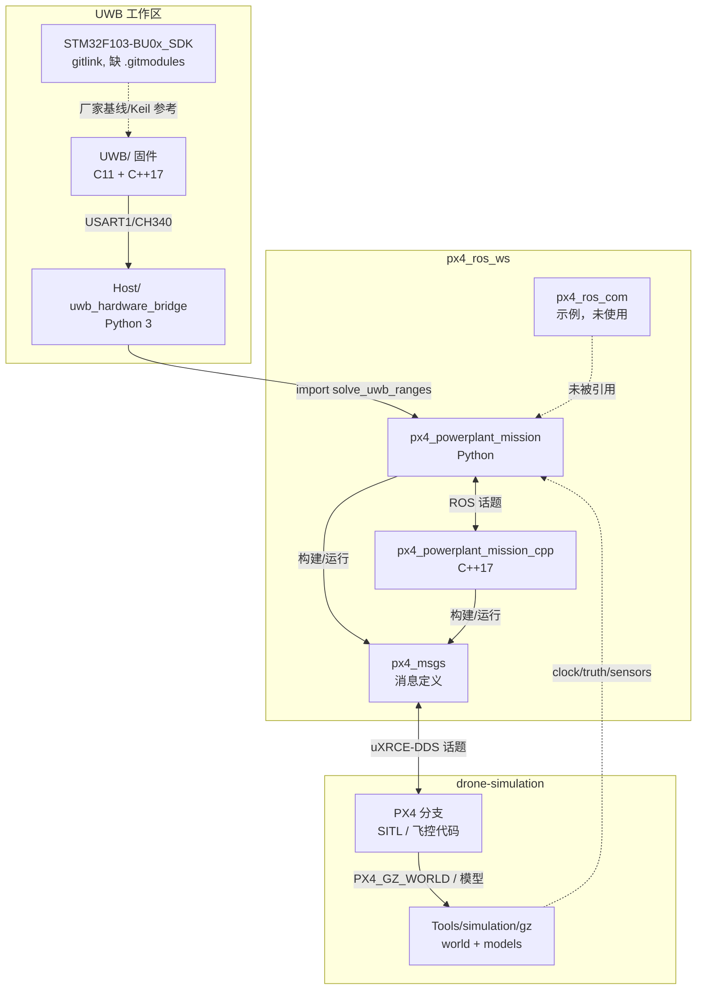

# 仓库、目录与依赖映射

> **路径约定**：仓库级路径写作 `src/px4_powerplant_mission/...` 或 `src/px4_powerplant_mission_cpp/...`；包内短路径 `config/…`、`launch/…`、`nodes/…` 相对于 `src/px4_powerplant_mission/`，`src/…`、`include/…`、`test/…`、`scripts/…` 相对于 `src/px4_powerplant_mission_cpp/`；`UWB/…`、`Host/…` 相对于 `C:\Users\pawn-\UWB-loaclization\`；`Tools/simulation/gz/…`、`ROMFS/…` 相对于 `/home/pawn/drone-simulation/`。

> 证据基线：2026-10-26。本文只描述**本地实际可访问**的三个工作空间；无法访问的仓库、硬件和远端 Issue 明确标为 `[待核实]`。  
> 标签：`[事实]` / `[推断]` / `[建议]` / `[待核实]`。  
> 相关文档：[总览](README.md) · [运行模式](runtime-modes.md) · [模块目录](module-catalog.md) · [依赖图](dependency-map.md) · [架构债务](architecture-debt.md)

## 1. 普查方法

- 用 `git status/log/remote/submodule`、目录遍历、`package.xml`/`CMakeLists.txt`/`setup.py` 读取真实结构；没有执行构建、烧录、飞行或提交。
- 三个根：`/home/pawn/px4_ros_ws`、`/home/pawn/drone-simulation`、`/mnt/c/Users/pawn-/UWB-loaclization`。
- 本文中的 `px4_ros_ws` 行号均指**当前工作树**，不是 HEAD 的干净版本。

## 2. 仓库清单

| 仓库/目录 | 远端与版本 | 规模/状态 | 角色 |
|---|---|---|---|
| `px4_ros_ws` | `github.com/pawn-queen/px4_ros_ws`；`main`；HEAD `9931daf7`；工作树含本次 Python legacy 删除/fixture 迁移 | 本次删除修改/删除多文件；新增 `test/fixtures/`；与 `origin/main` 同步 | 机载任务栈主工作区 |
| `px4_ros_ws/src/px4_msgs` | PX4 官方 `github.com/PX4/px4_msgs`；gitlink `7abb737`；版本 2.0.1 | 255 个跟踪文件；246 个 `msg`；干净 | PX4 uORB 消息的 ROS 2 映射 |
| `px4_ros_ws/src/px4_ros_com` | PX4 官方 `github.com/PX4/px4_ros_com`；gitlink `86e9aeb`（`beta-384`） | 28 个跟踪文件；干净；已安装 | 官方示例/`frame_transforms`，**业务包未引用** |
| `drone-simulation` | `git@github.com:pawn-queen/drone-simulation.git`；`main`；HEAD `d0a0e3cc3c`；`v1.17.0-alpha1-1645-gd0a0e3cc3c`；49,681 个提交；上游基点 `89806574`（2026-04-29） | 13,819 个跟踪文件；约 8.8 GB（`build/` 7.6 GB 未跟踪）；本地相对基点仅 2 个文件、+15/−1；`Tools/simulation/gz` 有 1 个未提交模型修改 | PX4 分支 + Gazebo 仿真资源 |
| `drone-simulation/Tools/simulation/gz` | 实际为 `github.com/pawn-queen/PX4-gazebo-models` 的 `powerplant-sim` 分支；gitlink `2dda48c`；`.gitmodules` 却声明 PX4 上游 `main` | 208 个跟踪文件；`M models/x500_depth/model.sdf`；本地提交 `80c6a2b`（world/model）、`2dda48c`（雷达） | `powerplant` world、`x500_depth` 雷达模型 |
| `UWB-loaclization` | `github.com/pawn-queen/UWB-loaclization`；`main`；HEAD `fb5f43d`；4 个提交 | 307 个跟踪文件；152 个 `M` 但 `--ignore-cr-at-eol` 后内容无差异；与 `origin/main` 同步 | UWB 固件 + Host |
| `UWB-loaclization/STM32F103-BU0x_SDK` | 厂家 `gitee.com/Ai-Thinker-Open/STM32F103-BU0x_SDK`；gitlink `1a0ce6c` | 245 个跟踪文件；**缺 `.gitmodules` 映射**；147 个脏项中 9 个为真实 Keil/IDE 改动 | 厂家 SDK/示例；不是本项目主构建入口 |

`[事实]` `px4_ros_ws` 的两个 gitlink 在 `.gitmodules` 中的 URL 是 `./src/px4_msgs`、`./src/px4_ros_com`（`.gitmodules:1-6`），同时这两个路径又被 `.gitignore` 忽略（`.gitignore:12-13`）。这意味着按当前 `.gitmodules` 做 `git submodule update --init` 不会指向 PX4 官方仓库。`[推断]` 干净 clone + 递归子模块无法按文档获得正确的消息/示例包。

`[事实]` `UWB-loaclization` 的 152 个“修改”全部是 CRLF↔LF：`git diff --stat --ignore-cr-at-eol` 只剩 `STM32F103-BU0x_SDK` 一个 gitlink 条目，内容差异为 0；仓库没有 `.gitattributes`，`core.autocrlf` 未设置。`[建议]` 先加 `.gitattributes` 再处理真实 diff，否则 11 万行噪声会掩盖 SDK 的 9 个真实改动。

## 3. 目录树（注释版）

```text
px4_ros_ws/
├── AGENTS.md                     # Agent 协作约定；指向 docs/agents/*
├── docs/
│   ├── agents/                   # 领域文档/Issue/标签约定
│   └── architecture/             # 本次普查输出（新增）
├── src/
│   ├── px4_msgs/                 # gitlink：PX4 消息（构建依赖）
│   ├── px4_ros_com/              # gitlink：官方示例（业务未引用）
│   ├── px4_powerplant_mission/   # ament_python：定位/UWB/EV/YOLO + launch/config
│   │   ├── config/               # powerplant.yaml + localization_* + p2_*
│   │   ├── launch/               # system / gz_sensor_bridge / visualization
│   │   ├── models/yolo/          # best.pt / yolov8n.pt（约 12 MB）
│   │   ├── px4_powerplant_mission/
│   │   │   ├── common/           # frames / qos
│   │   │   ├── localization/     # inputs / uwb / fusion
│   │   │   └── nodes/            # 4 个 Python 节点
│   │   ├── test/                 # 8 个 Python 测试文件
│   │   └── rviz/                 # powerplant_visualization.rviz
│   └── px4_powerplant_mission_cpp/ # ament_cmake：C++ 建图/规划/控制
│       ├── config/               # p0 依赖锁定
│       ├── include/              # 16 个 .hpp
│       ├── src/                  # 21 个 .cpp
│       ├── scripts/              # P0 基线 / P2 SITL / GCS / 包络推导
│       ├── test/                 # C++ 测试 + fixtures + p2_*.sdf 世界
│       └── research_sources/     # SITL 机体包络证据
├── build/ install/ log/          # 构建/安装/运行产物（未跟踪）
├── .p0_deps/                     # 可选 Cyclone DDS 本地解包（未跟踪）
└── .venv/                        # YOLO 推理依赖（未跟踪）
```

`[事实]` Python 包通过 `setup.py:28-34` 注册 4 个节点入口；`data_files` 安装 `config/`、`launch/`、`models/yolo/`、`rviz/`（`setup.py:10-17`）。C++ 包通过 `CMakeLists.txt:23-36` 生成 2 个库、2 个可执行文件。

**UWB 工作区（`C:\Users\pawn-\UWB-loaclization\`）**

```text
UWB-loaclization/
├── Host/                         # 独立 ament_python 包 uwb_hardware_bridge
│   ├── uwb_hardware_bridge/      # cli/config/protocol/processing/session/recording/replay/ros_node/solver
│   ├── config/hardware.example.yaml
│   ├── launch/hardware.launch.py
│   └── tests/                    # 假串口、PTY、同进程 ROS
├── UWB/                          # STM32F103 + DW3000 固件
│   ├── App/                      # app.cpp / uwb_service.cpp
│   ├── BSP/                      # board / dw3000_port / serial_transport / config_store / crc32
│   ├── Boards/BU03|BU04/         # CubeMX .ioc、生成 Core、sources.cmake
│   ├── Middleware/{DW3000,AiThinker}/
│   ├── cmake/ + CMakeLists.txt   # GCC 构建
│   ├── MDK-ARM/ + tools/         # Keil 工程、构建/同步/验证脚本
│   └── build/                    # 八组构建产物（未跟踪）
├── STM32F103-BU0x_SDK/           # 厂家 SDK，gitlink，缺 .gitmodules
├── reference/                    # 原理图、规格书、调研
└── docs/agents/                  # 协作/Issue/领域文档约定
```

**仿真工作区（`/home/pawn/drone-simulation`）**

```text
drone-simulation/
├── ROMFS/px4fmu_common/init.d-posix/airframes/
│   ├── 4001_gz_x500              # PX4_GZ_WORLD / PX4_SIM_MODEL 入口
│   └── 4002_gz_x500_depth        # 室内 EV / 无 GPS/磁 参数
├── msg/ + msg/versioned/         # uORB 消息（与 px4_msgs 对应）
├── src/modules/simulation/gz_bridge/  # gz_<model>[_<world>] CMake 目标
├── Tools/simulation/gz/          # 子模块：worlds/ + models/ + tools/
│   ├── worlds/powerplant.sdf
│   └── models/x500_depth/model.sdf
└── build/px4_sitl_default/       # 已构建 PX4 + 运行产物（未跟踪）
```


## 4. ROS 2 包清单

| 包 | 构建类型 | 版本 | 入口/产物 | 默认是否参与任务 | 证据 |
|---|---|---|---|---|---|
| `px4_powerplant_mission` | `ament_python` | 0.1.0 | `localization_node`、`external_vision_bridge_node`、`uwb_simulator_node`、`yolo_detector_node` | 定位/EV 默认开；UWB 仿真默认开；建图默认 C++；YOLO/控制默认关 | `package.xml:10-31`；`setup.py:28-34` |
| `px4_powerplant_mission_cpp` | `ament_cmake` | 0.1.0 | 库 `powerplant_core`、`powerplant_mission`；可执行 `voxel_mapper_node`、`offboard_mission_node` | 建图默认开；控制默认关（`use_control=false`） | `package.xml:1-29`；`CMakeLists.txt:23-36` |
| `px4_msgs` | `ament_cmake` | 2.0.1 | 246 个消息/服务定义 | 构建/运行依赖 | `src/px4_msgs/package.xml:1-10` |
| `px4_ros_com` | `ament_cmake` | 0.1.0（`beta-384`） | 示例节点 + `libframe_transforms.so` | **否** | 两个业务包 `package.xml` 均无 `px4_ros_com`；`install/px4_ros_com` 存在 |
| `uwb_hardware_bridge`（外部） | `ament_python` | 0.1.0 | `uwb-host`、`uwb_hardware_node`；4 个话题 + 2 个服务 | 仅实机 | `Host/package.xml:2-18`；`Host/setup.py:23-26` |

`[事实]` `px4_powerplant_mission` 在元数据上 `exec_depend` 了 `px4_powerplant_mission_cpp`（`package.xml:11`），但 Python 代码没有 import C++；这是“默认执行器切换”的包级声明，不是编译依赖。反过来，C++ 的 pytest 契约测试把 Python 包加入 `PYTHONPATH`（`CMakeLists.txt:98-109`），形成测试期反向依赖。`[推断]` 两个包不能独立发布/独立版本化。

## 5. 构建与启动入口

### 5.1 主工作区

| 目标 | 命令/入口 | 证据 |
|---|---|---|
| 构建两个业务包 | `colcon build --symlink-install --packages-up-to px4_powerplant_mission --executor sequential --parallel-workers 1 --cmake-args -DPython3_EXECUTABLE=/usr/bin/python3 -DCMAKE_BUILD_TYPE=Release` | `src/px4_powerplant_mission/README.md:32-39` |
| 仅构建 C++ | `colcon build --packages-select px4_powerplant_mission_cpp ...` | `src/px4_powerplant_mission_cpp/P0_VALIDATION.md:84-91` |
| 测试基线 | `bash src/px4_powerplant_mission_cpp/scripts/run_p0_baseline.sh` | `src/px4_powerplant_mission_cpp/scripts/run_p0_baseline.sh:1-19` |
| 完整 SITL 验收 | `run_p2_sitl.py --scenario room --detection-mode replay` | `src/px4_powerplant_mission_cpp/P2_VALIDATION.md:31-47`；`src/px4_powerplant_mission_cpp/scripts/run_p2_sitl.py:249-329` |
| 启动任务栈 | `ros2 launch px4_powerplant_mission powerplant_system.launch.py` | `src/px4_powerplant_mission/README.md:79-86` |
| 传感器桥 | `ros2 launch px4_powerplant_mission gz_sensor_bridge.launch.py` | `src/px4_powerplant_mission/launch/gz_sensor_bridge.launch.py:42-58` |
| RViz | `ros2 launch px4_powerplant_mission visualization.launch.py` | `src/px4_powerplant_mission/launch/visualization.launch.py:10-27` |

`[事实]` 工作区根目录没有顶层 `Makefile`、`install.sh` 或一键启动脚本；构建入口只存在于包文档和上述脚本中。`find . -maxdepth 2 -name '*.sh' -o -name 'Makefile'` 无结果。

### 5.2 仿真工作区

| 目标 | 命令/入口 | 证据 |
|---|---|---|
| 构建并启动 PX4 SITL | `PX4_GZ_WORLD=powerplant make px4_sitl gz_x500_depth` | `src/px4_powerplant_mission/README.md:72-77` |
| 世界选择 | 机型脚本 `4002_gz_x500_depth` 继承 `4001_gz_x500`，后者读取 `PX4_GZ_WORLD` | `drone-simulation/ROMFS/px4fmu_common/init.d-posix/airframes/4001_gz_x500:17`；`4002_gz_x500_depth:11-24` |
| 已构建二进制 | `build/px4_sitl_default/bin/px4`（约 56 MB） | 本机 `ls -lh`；`src/px4_powerplant_mission_cpp/scripts/run_p2_sitl.py:256-257` |
| Gazebo | 系统 `gz sim 8.11.0`；`powerplant` world | 本机 `gz sim --versions`；`Tools/simulation/gz/worlds/powerplant.sdf:3` |

`[事实]` `gz_x500_depth` 不是 PX4 `Makefile` 里的手写目标，而是 `gz_bridge` 的 CMake 自定义目标：它扫描 `Tools/simulation/gz/worlds/*.sdf` 与 `airframes/*_gz_*` 生成 `gz_<model>[_<world>]`（`src/modules/simulation/gz_bridge/CMakeLists.txt:43-44,98-120`）；`make px4_sitl gz_x500_depth` 仍可用，因为该目标已生成到 `build.ninja`。`[事实]` 手工仿真使用 `drone-simulation/Tools/simulation/gz/worlds/powerplant.sdf`，而 P2 脚本使用主工作区的 `test/worlds/p2_<scenario>.sdf`（`src/px4_powerplant_mission_cpp/scripts/run_p2_sitl.py:258`）；两者 world name 都是 `powerplant`，但内容/模型不同。`[推断]` 这是“同一个世界名、两套世界文件”的隐性耦合。

`[事实]` `run_p2_sitl.py` 自己启动 Agent、Gazebo、PX4、GCS、传感器桥和任务栈（`src/px4_powerplant_mission_cpp/scripts/run_p2_sitl.py:319-329`），是当前唯一把三套进程串起来的仿真入口；它不构建 PX4（`src/px4_powerplant_mission_cpp/P2_VALIDATION.md:29`）。

### 5.3 UWB 工作区

| 目标 | 命令/入口 | 证据 |
|---|---|---|
| 固件 GCC 构建 | `UWB/tools/build.ps1 -Board BU03 -Toolchain GCC -Configuration Debug` | `UWB/README.md:11-27`；`UWB/tools/build.ps1:1-30` |
| 固件全量验证 | `UWB/tools/verify.ps1 -Build`（两板 × 两工具链 × Debug/Release） | `UWB/README.md:18-20` |
| Host 构建 | `colcon build --base-paths . --packages-select uwb_hardware_bridge` | `Host/README.md:67-75` |
| Host 运行 | `ros2 launch uwb_hardware_bridge hardware.launch.py config:=/path/hardware.yaml` | `Host/launch/hardware.launch.py:1-28` |
| 测试 | `pytest Host/tests`（假串口/PTY） | `Host/README.md:95-111` |

`[事实]` Host 是**独立 colcon 包**，不复制进 `px4_ros_ws`；它通过 `package.xml` 声明 `exec_depend px4_powerplant_mission`（`Host/package.xml:18`），运行时必须能 import 主工作区的 Python 包。

## 6. 外部运行时与不可访问项

| 依赖 | 本地状态 | 角色 | 证据 |
|---|---|---|---|
| ROS 2 Jazzy / Ubuntu 24.04.4 / x86_64 | 已安装 | 主工作区运行时 | 本机 `lsb_release`、`uname`、`ROS_DISTRO` |
| Micro XRCE-DDS Agent | `/usr/local/bin/MicroXRCEAgent`；源码 `/home/pawn/Micro-XRCE-DDS-Agent` v2.4.3 | PX4 ↔ ROS 2 DDS 桥 | `src/px4_powerplant_mission/README.md:65-70`；本机 `--version` 不可用但源码 tag 为 v2.4.3 |
| Gazebo | 8.11.0 | 仿真传感器/世界 | 本机 `gz sim --versions` |
| PX4 另一 checkout | `/home/pawn/PX4-Autopilot`，`v1.17.0-alpha1-1334-gdd2530bb09`，约 4.4 GB | 与 `drone-simulation` 重复；未参与任务栈 | 本机 `git log/du` |
| QGroundControl | `~/QGroundControl-x86_64.AppImage` | 可选 GCS；P2 用独立 `p2_sitl_gcs.py` | 本机文件；`src/px4_powerplant_mission_cpp/P2_VALIDATION.md:41-45` |
| 真实飞控/电调/电机 | 未连接 | 实机执行层 | `[待核实]` |
| 真实相机/雷达/深度驱动 | 仓库内无包 | 实机传感器输入 | `src/` 下仅 4 个 `package.xml` |
| Jetson 部署仓库/镜像 | 未发现 | 机载部署 | `[待核实]`；全仓无 Jetson/aarch64 业务代码 |
| GitHub Issue #2 | 文档引用 | P2 规格/缺口 | `src/px4_powerplant_mission_cpp/MIGRATION_STATUS.md:7`；本次未联网读取，`[待核实]` |

## 7. 与 PX4、部署仓库、外部驱动仓库的关系

| 对象 | 本地是否存在 | 实际关系 | 证据 |
|---|---|---|---|
| PX4 上游 `PX4/PX4-Autopilot` | 存在另一 checkout `/home/pawn/PX4-Autopilot`（`v1.17.0-alpha1-1334-gdd2530bb09`，2026-04-04） | `drone-simulation` 是它的 fork/衍生；任务栈不直接依赖这份 checkout，默认用 `drone-simulation/build/px4_sitl_default` | 本机 `git log/describe`；`run_p2_sitl.py:106,256-257` |
| `px4_msgs` | 是主工作区 gitlink，内容存在 | 任务栈的编译/运行消息依赖；与本地 PX4 有轻微字段漂移 | `src/px4_msgs`；`CMakeLists.txt:10`；见 D2 |
| `px4_ros_com` | 是主工作区 gitlink，已安装 | 官方示例；两个业务包均未引用 | `src/px4_ros_com/package.xml`；业务包 `package.xml` 无引用 |
| UWB 部署/上位机仓库 | 存在独立的 `UWB-loaclization`（不是 `px4_ros_ws` 的子目录） | Host 作为独立 ROS 2 包运行，通过 import 复用主工作区解算器 | `Host/package.xml:18`；`Host/uwb_hardware_bridge/solver.py:12` |
| 外部相机/雷达/深度驱动仓库 | 本地未发现 | 硬件 profile 需要这些话题的真实生产者，但主工作区没有对应包 | `src/` 仅 4 个 `package.xml`；`config/powerplant.yaml:6,105-108` |
| 独立 Jetson 部署仓库/镜像 | 本地未发现 | 无法分析其内部结构；Jetson 运行方式只能标记待核实 | 全仓无 `Dockerfile`/`*.service`/aarch64 业务代码 |

`[事实]` 没有发现一个独立的“部署仓库”被三个工作空间引用；现有部署知识主要写在 README、`P0_VALIDATION.md`、`P2_VALIDATION.md` 和脚本默认值里。`[推断]` 这意味着“部署”目前是操作约定，不是可版本化的产物。

## 8. 依赖映射



`[事实]` 图中最关键的跨仓库边是：Host→主工作区 Python 解算器（源码级 import）、`px4_msgs`↔PX4（DDS 序列化）、Gazebo 模型↔主工作区（话题名、安装偏移、世界名）。这三条边都没有 CI 或版本锁保护，详见 [dependency-map.md](dependency-map.md) 与 [architecture-debt.md](architecture-debt.md)。

## 9. Git 历史（主工作区）

| 提交 | 日期 | 变更主题 | 对架构的影响 |
|---|---|---|---|
| `8b441f6e` | 2026-05-13 | 初始仿真栈 | Python 单栈、Gazebo 世界、基础控制 |
| `324ec600` | 2026-05-13 | 打包 YOLO 模型 | 12 MB 模型进入包数据 |
| `168dde05` … `9c53030e` | 2026-05-14 至 05-17 | 航点、UWB 定位、避障 | 逐步引入 UWB/外部视觉 |
| `c18926c2` | 2026-10-21 | 迁移 C++ 建图/规划/Offboard | 双栈并存开始 |
| `071503ea` | 2026-10-24 | 解耦仿真/实机，EV 直接接独立 UWB | `localization_profile` 与硬件话题出现 |
| `e5f795d2` | 2026-10-25 | 文档更新 | 历史提交 |
| `4800616b` | 2026-10-26 | P2 轨迹/拓扑/巡检入库 | P2 源码/测试/文档成为提交内容 |
| `9931daf7` | 2026-10-30 | CI smoke/测试加固 | 本次删除前的当前 HEAD |
| 工作树 | 2026-10-30 | 删除 Python legacy + fixture 迁移 | **未提交**，见 [D1](architecture-debt.md#d1-本次删除改动未提交) |

`[事实]` 当前 `main` 与 `origin/main` 已同步（`git rev-list --left-right --count` 为 0/0）。

**其他仓库关键提交**

| 仓库 | 提交 | 主题 |
|---|---|---|
| UWB | `c36a0fc` / `9338eb6` / `fb5f43d` | 初始工程 / DW3000 驱动与 TWR 移植 / Host 外部接口与 ROS 2 输出 |
| drone-simulation | `31136c9043` / `ca58312749` / `d0a0e3cc3c` | gz 子模块指向 powerplant / 雷达模型 / POSIX 室内 airframe |


## 10. 已证实的版本/耦合细节

- `[事实]` `drone-simulation` 相对上游基点 `89806574` 只有 2 个文件、+15/−1：`ROMFS/.../4002_gz_x500_depth` 与 gz gitlink；`msg/`、`src/modules/`、`boards/` 没有本地修改。`[推断]` 用户“只改 Gazebo 仿真环境”的判断基本成立，但“只改 Gazebo”不包含 PX4 侧 airframe 参数（`4002` 仍改了 14 行）。
- `[事实]` gz 子模块的 `.gitmodules` 声明 PX4 上游 `main`，实际检出 fork 的 `powerplant-sim` 分支；`git submodule update --remote` 会丢失 `powerplant` world 与雷达模型。`[建议]` 改为记录 fork URL + 固定 SHA，或在 `.gitmodules` 中明确分支。
- `[事实]` `px4_msgs` 与本仓库 PX4 的 246 个消息中 242 个逐字节相同；`FailsafeFlags` 少 `gnss_lost`、`AuxGlobalPosition` 少 `SOURCE_LEO`，其余关键消息（`VehicleOdometry` 等）一致。`[推断]` 主用话题大概率兼容，`failsafe_flags`/`AuxGlobalPosition` 有字段漂移风险。
- `[事实]` `drone-simulation` 的构建版本宏是 `v1.17.0-alpha1-1643-g31136c9043`，落后 HEAD 的 1645 两个提交；`build/` 7.6 GB 未跟踪。`[推断]` 二进制与源码不是严格同一提交，排障时不能只信 `git describe`。
- `[事实]` P2 运行器使用 `test/worlds/p2_*.sdf` 并把模型复制到 `local_models`（`src/px4_powerplant_mission_cpp/scripts/run_p2_sitl.py:258,313`）；手工流程使用 `Tools/simulation/gz/worlds/powerplant.sdf`。应用话题 `/model/x500_depth/...`（`src/px4_powerplant_mission/launch/powerplant_system.launch.py:108-111`）与 Gazebo 实例名 `x500_depth_0`（`src/px4_powerplant_mission_cpp/scripts/run_p2_sitl.py:997`）并不完全一致，视频/真值桥的命名耦合靠配置和 README 维持。`[待核实]` 这是否会导致某些桥接话题在 P2 中缺失，需要用实际 `gz topic -l` 验证。

## 11. 待核实与缺口

- `[待核实]` PX4 上游基线：`drone-simulation` 无 upstream remote；已确认本地基点为 `89806574`，但无法证明它对应 PX4 官方哪个发布分支。
- `[待核实]` `px4_msgs` 与本地 PX4 的**运行时**兼容性：已完成 246 个消息的逐字节比对（242 个相同），但未在真实 PX4 上验证 `FailsafeFlags` 的反序列化/字段语义。
- `[待核实]` GitHub Issue #2 的验收项与当前工作树是否一致：本次未联网。
- `[待核实]` Jetson 的 OS/ROS 版本、USB/串口、DDS 网络与算力预算：仓库内无证据。
- `[待核实]` 真实相机/雷达的型号、驱动、安装外参与时间同步：仓库内无驱动包/标定文件。
- `[待核实]` UWB 实板型号、固件版本、锚点坐标与串口设备：只有示例配置，`coordinates_measured: false`（`Host/config/hardware.example.yaml:7`）。
