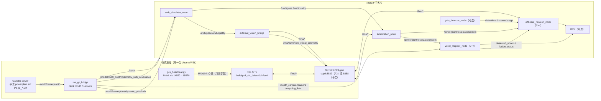
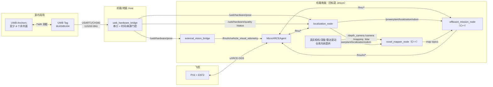
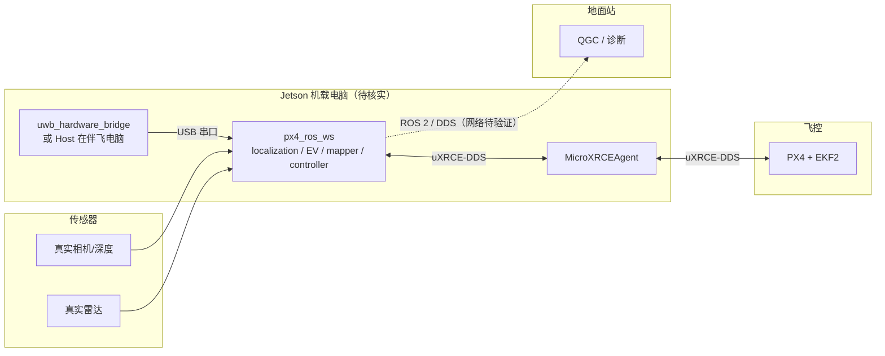

# 仿真与实机运行拓扑

> **2026-10-30 更新**：Python mapper/controller 已删除；launch 不再接受 `mapping_package`/`control_package`，mapper/controller 固定为 `px4_powerplant_mission_cpp`。本文中“Python 回退/双栈”段落是删除前历史。

> **路径约定**：仓库级路径写作 `src/px4_powerplant_mission/...` 或 `src/px4_powerplant_mission_cpp/...`；包内短路径 `config/…`、`launch/…`、`nodes/…` 相对于 `src/px4_powerplant_mission/`，`src/…`、`include/…`、`test/…` 相对于 `src/px4_powerplant_mission_cpp/`；`validation/…`、`tools/…` 相对于仓库根；`UWB/…`、`Host/…` 相对于 `C:\Users\pawn-\UWB-loaclization\`；`Tools/simulation/gz/…`、`ROMFS/…` 相对于 `/home/pawn/drone-simulation/`。

> 证据基线：2026-10-26。本文区分**代码支持的运行方式**、**本机实际观察到的运行方式**和**目标但未证实的运行方式**。  
> 标签：`[事实]` / `[推断]` / `[建议]` / `[待核实]`。  
> 相关文档：[总览](README.md) · [仓库映射](repository-map.md) · [模块目录](module-catalog.md) · [依赖图](dependency-map.md) · [架构债务](architecture-debt.md)

## 1. 运行模式矩阵

| 维度 | WSL2 仿真（当前开发环境） | 原生 Ubuntu 仿真 | Jetson 实机 | Windows 仅 UWB Host |
|---|---|---|---|---|
| 状态 | `[事实]` 本机存在并可启动 | `[推断]` 代码同构，未在本机验证 | `[待核实]` 仓库无部署证据 | `[事实]` Host 支持串口 CLI |
| OS / ROS | Ubuntu 24.04.4 / ROS 2 Jazzy / x86_64 | 同左（推测） | 未知；仓库只写 ROS 2 Jazzy | Windows + Python 3 |
| UWB 来源 | Gazebo 真值 → `uwb_simulator_node` | 同左 | 真实 BU03/BU04 → Host | 真实 BU03/BU04 → Host |
| PX4 | SITL（`drone-simulation` 已构建） | SITL | 真实飞控 | 不启动 |
| 传感器 | Gazebo 相机/深度/雷达 | 同左 | 真实驱动（仓库内缺失） | 无 |
| 时钟 | `/clock`，`use_sim_time=true` | 同左 | 墙钟，`use_sim_time=false` | 墙钟 |
| DDS | 默认 Fast DDS 本机异常；Cyclone+LOCALHOST 可用 | 需重新验证 | 未验证 | 不涉及 ROS 时可只用串口 |
| 结论 | `[推断]` 可用于开发/单元/部分 SITL | `[推断]` 需单独验收 | `[推断]` 不可按现状部署 | `[事实]` 可用于地面串口记录 |

`[事实]` 代码没有“仿真版/实机版”两个分支；同一套 Python/C++ 节点通过 `localization_profile`、`use_sim_time`、`uwb_*_topic` 和 `motion_config_file` 切换。见 `src/px4_powerplant_mission/launch/powerplant_system.launch.py:46-70` 与 `config/localization_simulation.yaml` / `localization_hardware.yaml`。

## 2. 仿真拓扑（SITL）

### 2.1 进程与数据流

`[事实]` 上图的进程组合由 `validation/sitl/run_acceptance.py:319-329` 实际启动：`agent`、`gazebo`、`px4`、`gcs`、`sensors`、`mission`；GUI 是可选项（`:330-331`）。手工运行时，README 只要求 Agent、PX4/Gazebo、任务 launch 三个终端（`src/px4_powerplant_mission/README.md:65-86`），传感器桥和 RViz 另开（`src/px4_powerplant_mission/README.md:209-227`）。

`[事实]` **两套 world 不要混淆**：手工流程启动 `drone-simulation/Tools/simulation/gz/worlds/powerplant.sdf`（内含 `power-plant` 模型）；P2 运行器启动主工作区 `validation/sitl/worlds/<scenario>.sdf`（`validation/sitl/run_acceptance.py:258`），两者 world name 都是 `powerplant`，因此 `/world/powerplant/*` 话题名相同但场景内容不同。`[推断]` 对照报告/截图时必须注明用的是哪套 world。

### 2.2 launch 默认行为

`[事实]` `powerplant_system.launch.py` 的默认值由 `config/runtime_profiles.json` 提供（`:82-110`）。`profile` 是新入口；`localization_profile` 保留为兼容入口，二者都设置时 `profile` 优先。

| 参数 | 默认 | 含义 |
|---|---|---|
| `profile` | 空 | 新入口；空时回退 `localization_profile`，设置后优先 |
| `localization_profile` | `simulation` | 兼容入口；选择 `localization_simulation.yaml` 与 `p2_simulation.yaml` |
| `use_localization` | `true` | 启动定位适配 |
| `use_external_vision` | `true` | 启动 EV 桥 |
| `use_uwb` | profile 默认 | simulation=true，hardware=false |
| `use_gazebo_truth_bridge` | profile 默认 | simulation=true，hardware=false |
| `use_gazebo_clock_bridge` | profile 默认 | simulation=true，hardware=false |
| `use_sim_time` | profile 默认 | simulation=true，hardware=false |
| `use_mapping` | `true` | 启动建图 |
| `use_yolo` | `false` | 默认不启 YOLO |
| `use_control` | `false` | 默认不启 Offboard |
| `yolo_python` | `/home/pawn/px4_ros_ws/.venv/bin/python` | 绝对路径 |

`[事实]` launch 本身**不启动** Gazebo 传感器桥；它只启动 `/clock` 和真值桥（`:90-116`）。传感器桥需要单独 `gz_sensor_bridge.launch.py`，P2 脚本把它作为独立的 `sensors` 进程启动（`validation/sitl/run_acceptance.py:325`）。`[推断]` 只运行 `powerplant_system.launch.py` 时，`/depth_camera`、`/camera`、`/mapping_lidar` 可能为空，建图不会产生有效地图。

### 2.3 P2 隔离参数

`[事实]` P2 脚本为每次验收创建独立运行目录，并设置（`validation/sitl/run_acceptance.py:290-317`）：

- `ROS_DOMAIN_ID=25`、`GZ_PARTITION=powerplant-p2-<pid>`、`GZ_IP=127.0.0.1`；
- Agent 端口 `8889`，`PX4_PARAM_UXRCE_DDS_PRT=8889`；
- `PX4_GZ_WORLD=powerplant`、`PX4_SIM_MODEL=gz_x500_depth`、`PX4_GZ_MODELS` 指向本地模型或外部模型；P2 的 Gazebo server 实际加载 `validation/sitl/worlds/<scenario>.sdf`（`:258`）；
- `PX4_PARAM_UXRCE_DDS_SYNCT=0`，定位/EV 的 `px4_timestamp_domain=ros`（`:276-279`；`docs/validation/sitl-acceptance.md:45`）；
- 独立 `px4_rootfs`，`etc` 只读符号链接到构建产物（`:285-289`）。

`[推断]` 这套隔离避免与手工运行的 PX4/Agent 抢占端口和参数；但 `ROS_DOMAIN_ID=25` 与正常手工运行的默认域不同，调试时必须显式设置同一域。

### 2.4 手工启动顺序（仿真）

| 步骤 | 终端 | 命令 | 说明 |
|---|---|---|---|
| 1 | 任意 | 构建并 `source install/setup.bash` | `src/px4_powerplant_mission/README.md:32-39` |
| 2 | 1 | `MicroXRCEAgent udp4 -p 8888` | `src/px4_powerplant_mission/README.md:65-70` |
| 3 | 2 | `cd /home/pawn/drone-simulation && PX4_GZ_WORLD=powerplant make px4_sitl gz_x500_depth` | `src/px4_powerplant_mission/README.md:72-77` |
| 4 | 3 | `ros2 launch px4_powerplant_mission powerplant_system.launch.py` | 默认不启控制/YOLO |
| 5 | 可选 | `ros2 launch ... gz_sensor_bridge.launch.py` | 传感器桥 |
| 6 | 可选 | `ros2 launch ... visualization.launch.py` | RViz |
| 7 | 任意 | `ros2 service call /start_powerplant_mission std_srvs/srv/Trigger` | 需先 `use_control:=true` |

`[事实]` 默认 `auto_start=false`，任务由服务触发（`config/powerplant.yaml:261`；`offboard_node.cpp:102-112`）。

## 3. 实机拓扑（UWB + PX4 + 真实传感器）

### 3.1 进程与数据流

`[事实]` 实机 UWB 链路是：固件只输出原始距离和来源/年龄元数据（`UWB/App/Src/uwb_service.cpp:307,327`；`UWB/README.md:7`），Host 解析后调用主工作区唯一解算器（`Host/uwb_hardware_bridge/solver.py:12`），再发布 `/uwb/hardware/pose|quality|status`（`Host/uwb_hardware_bridge/ros_node.py:79-95`）。主工作区硬件 profile 精确订阅这三个话题（`config/localization_hardware.yaml:4-7`）。

`[事实]` Host 有第四个话题 `/uwb/hardware/observations`（`ros_node.py:81,94`），主工作区没有订阅者；它用于诊断/记录，不参与控制。

### 3.2 硬件 profile 的默认行为

| 参数/行为 | 默认 | 证据 |
|---|---|---|
| `localization_profile:=hardware` | 关闭 UWB 仿真器、Gazebo 真值/时钟桥 | `src/px4_powerplant_mission/launch/powerplant_system.launch.py:52-55` |
| `use_sim_time` | `false` | 同上 |
| UWB 话题 | `/uwb/hardware/pose`、`/uwb/hardware/quality`、`/uwb/hardware/status` | `src/px4_powerplant_mission/config/localization_hardware.yaml:4-12` |
| UWB 姿态 | `use_uwb_orientation: false` / `use_independent_orientation: false` | 同上 `:7,13` |
| 建图 | 仍默认 `use_mapping:=true` | `src/px4_powerplant_mission/launch/powerplant_system.launch.py:56` |
| 控制 | 仍默认 `use_control:=false` | `:62` |
| 运动模型 | `motion_model_configured: false`，bootstrap 高度/时长 0 | `config/p2_hardware.yaml:1-10` |
| 起飞区 | `takeoff_region_confirmed: false`，高度 0 | `config/powerplant.yaml:275-280` |
| 照片目录 | 绝对路径 `/home/pawn/px4_ros_ws/inspection_photos` | `config/powerplant.yaml:363` |

`[事实]` 官方文档推荐的硬件首验命令只启定位/EV、关闭建图：`localization_profile:=hardware use_mapping:=false`（`src/px4_powerplant_mission/LOCALIZATION_DEPLOYMENT.md:35-42`）。`[推断]` 这只验证 UWB→EV→PX4 的定位链，不验证相机/雷达/建图/控制；完整硬件任务栈需要额外驱动、外参和运动标定。

### 3.3 实机启动顺序（当前文档支持的部分）

| 步骤 | 操作 | 证据/边界 |
|---|---|---|
| 1 | 烧录/配置 BU03/BU04 固件；至少 4 个非共面 Anchor；Tag/Anchor 信道速率一致 | `UWB/README.md:30-42`；`Host/README.md:22-24` |
| 2 | 写 `hardware.yaml`：串口、Tag ID、Anchor ID/实测 ENU、`coordinates_measured: true` | `Host/config/hardware.example.yaml:1-27` |
| 3 | 启动 Host：`ros2 launch uwb_hardware_bridge hardware.launch.py config:=...` | `Host/launch/hardware.launch.py:1-28` |
| 4 | 启动 PX4 飞控 + `MicroXRCEAgent` | `src/px4_powerplant_mission/README.md:65-70`；`src/px4_powerplant_mission/LOCALIZATION_DEPLOYMENT.md:35-42` |
| 5 | 启动主工作区：`localization_profile:=hardware use_mapping:=false` | `src/px4_powerplant_mission/LOCALIZATION_DEPLOYMENT.md:35-42` |
| 6 | 验证 `/uwb/hardware/pose`、`/fmu/in/vehicle_visual_odometry`、EKF flags | `src/px4_powerplant_mission/README.md:116-136` |
| 7 | 接入真实相机/雷达驱动，配置外参，启建图 | `[待核实]` 仓库无驱动/标定 |
| 8 | 配置 `motion_config_file`、起飞柱体，启控制并手动 START | `src/px4_powerplant_mission/README.md:405-413`；`config/p2_hardware.yaml:1-10` |

`[事实]` Host 节点强制 `use_sim_time=false`（`ros_node.py:84-85`，`hardware.launch.py:23`），因此不能把仿真 launch 的 `/clock` 配置直接套到实机。

## 4. WSL 与原生 Ubuntu 的差异

| 维度 | WSL2（本机实测） | 原生 Ubuntu（推测） |
|---|---|---|
| 内核/显示 | WSL2 内核；Gazebo GUI 依赖 WSLg | 原生 GUI/GPU |
| 代码 | 同一份 `px4_ros_ws` / `drone-simulation` | 同一份代码 |
| 构建内存 | 文档要求串行构建，避免与 Gazebo 同时跑 | 可按机器资源调整，但仓库未给原生配置 |
| Windows 文件 | UWB 工作区在 `/mnt/c`，Host 可在 Windows 或 WSL 运行 | 不涉及 `/mnt/c` |
| 串口 | WSL 需人工 USB 接入/转发 | 直接 `/dev/serial/by-id/...` |
| DDS | 本机 Fast DDS 异常；Cyclone+LOCALHOST 可恢复同机通信 | 需重新验证；不能假设 WSL 结论成立 |
| 证据 | 本机 `uname`、`lsb_release`；`docs/validation/input-map-health.md:62-78`；`Host/README.md:111` | `[推断]`，未在原生机运行 |

`[事实]` 本机是 `Ubuntu 24.04.4 LTS`、WSL2 内核 `6.18.33.2-microsoft-standard-WSL2`、`x86_64`、ROS `jazzy`（本次命令输出）。仓库没有针对 WSL 的代码分支；差异主要在 DDS、USB、GPU/内存。

## 5. Jetson 实机（待核实）

`[事实]` 在 `px4_ros_ws`、`UWB-loaclization` 的源码/文档中检索 `jetson|aarch64|arm64|orin`，没有业务命中；仓库没有 `Dockerfile`、`*.service`、`docker-compose*`、`setup.sh`/`install.sh`。`tools/env/ros_dependencies.json:2` 明确限定 `ubuntu-noble-amd64`，`tools/env/bootstrap_ros.py:24-26` 对非 `noble`/非 `x86_64` 直接报错。

`[待核实]` 因此以下都**不是已证实事实**：

- Jetson 型号、JetPack/Ubuntu 版本、ROS 2 发行版（仓库假设 Jazzy）；
- ARM64 上是否有 `px4_msgs`、`cv_bridge`、OpenCV、Eigen、JsonCpp、Cyclone/Fast DDS 的可用包；
- UWB Host 与飞控的串口拓扑（Jetson USB/Telem）；
- 机载 DDS 网络、systemd 看护、日志与回滚；
- CPU/GPU 预算与 YOLO 推理时延。

`[建议]` 若 Jetson 是目标平台，先做一份最小部署清单：固定 OS/ROS 镜像 → 原生 ARM64 构建两个业务包 → 验证 Agent/PX4 DDS → 验证 UWB Host 串口 → 再谈建图/控制。不要复用 `.p0_deps` 的 amd64 解包。

**目标形态（未验证，仅用于讨论）**

`[待核实]` 图中每一条虚线/实线都还没有在 Jetson 上验证；尤其 Host 放机载还是地面、USB 供电/枚举、DDS 跨网段、QGC 连接方式。

## 6. 时钟、坐标与健康契约

| 主题 | 仿真 | 实机 | 证据 |
|---|---|---|---|
| 时钟源 | Gazebo `/clock`；`use_sim_time=true` | 墙钟；`use_sim_time=false` | `src/px4_powerplant_mission/launch/powerplant_system.launch.py:55`；`localization_hardware.yaml` |
| PX4 时间域 | P2 锁步用 `px4_timestamp_domain=ros`，`UXRCE_DDS_SYNCT=0` | 默认 `system`，依赖 uXRCE 时间同步 | `validation/sitl/run_acceptance.py:276-279,300`；`src/px4_powerplant_mission/LOCALIZATION_DEPLOYMENT.md:82-84` |
| 坐标 | PX4 NED/FRD ↔ ROS ENU/FLU；`map` 与 PX4 local NED 原点对齐 | 同左，需实测锚点/外参 | `common/frames.py:1-12`；`src/px4_powerplant_mission/LOCALIZATION_DEPLOYMENT.md:62-76` |
| UWB 时间 | 每个 Gazebo 采样时间生成一组测距 | Host 用测量 UTC 时间，保留到 `timestamp_sample` | `uwb_simulator_node.py:232-245`；`src/px4_powerplant_mission/LOCALIZATION_DEPLOYMENT.md:82-84` |
| 健康/epoch | `status_stamp_ns/sequence/localization_epoch`；PX4 reset/时钟回退换 epoch | 同左 | `localization_node.py:591-651`；`docs/validation/input-map-health.md:42-58` |
| 地图协议 | `map_epoch/sequence/observed_cloud_fingerprint` | 同左 | `docs/validation/input-map-health.md:49-58` |

`[推断]` 时钟域是这套系统最容易被“看起来能跑”掩盖的接口：同一份代码在仿真用 `ros` 域、实机用 `system` 域；如果 launch/参数被手工覆盖，UWB 样本会被判过期或 EV 不融合，但节点仍可能正常启动。

## 7. 当前运行状态（实测证据）

| 检查 | 结果 | 证据 |
|---|---|---|
| runtime C++/契约测试 | 244 项，0 失败 | 本机 `colcon test-result --test-result-base build/px4_powerplant_mission_cpp` |
| Python 回归 | 77 项，0 失败（删除 legacy 后） | 本机 `pytest src/px4_powerplant_mission/test` |
| validation 回归 | 148 项，0 失败 | 本机 `pytest validation/tests` |
| 最新完整 SITL | **未通过**：`passed=false`，`exit_reason=mission_fault`；阶段 `IDLE→START→SAFE_TAKEOFF→FAULT` | `log/p2_sitl_cpu_17/report.json` |
| 失败原因 | `MOTION_TRACKING_ERROR_EXCEEDS_CERTIFICATE`，在起飞段触发安全停止 | `log/p2_sitl_cpu_17/events.jsonl` |
| 原始传感器负载 | 未通过健康启动；CPU 10 Hz 仍慢于实时 | `docs/history/migration-status.md:32` |
| 实机 | 未验证 | `Host/README.md:102-111`；`docs/validation/input-map-health.md:78` |

`[推断]` 当前状态是“架构与单元契约基本成形，完整闭环仍在调试”。测试通过说明接口/算法回归受控，不说明飞行能力；最新 SITL 失败说明运动证书/跟踪门限与 PX4 起飞响应仍未对齐。

## 8. 部署检查清单（建议）

- `[建议]` 仿真：固定 `ROS_DOMAIN_ID`、Agent 端口、`GZ_PARTITION`；确认 `/clock` 与 `/depth_camera` 时间戳同域。
- `[建议]` 实机：先只启 Host + 定位/EV，确认 `/uwb/hardware/pose` 的 frame、时间、协方差和拒绝原因；再启建图。
- `[建议]` 实机：`takeoff_region_confirmed`、`motion_model_configured`、相机/雷达外参必须有实测来源，不能复制 SITL 值。
- `[建议]` Jetson：固定镜像与 ROS 版本；用 systemd/容器托管；把 DDS、串口、日志、回滚纳入验收。
- `[建议]` 任何部署：记录 `git rev-parse HEAD`、`git status`、子模块 SHA、PX4 版本、Agent 版本和 launch 参数，作为报告的一部分。
