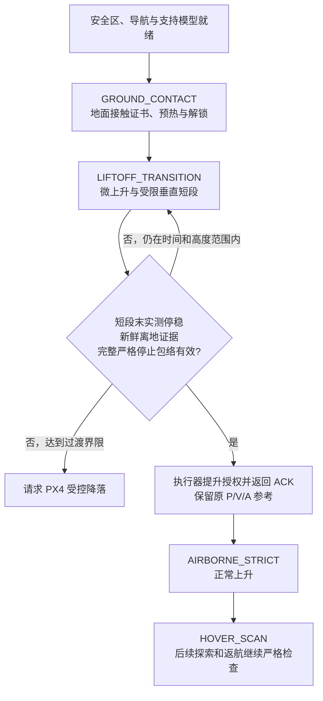

# 起飞地面接触保护：原理、坐标与安全边界

本说明对应 Issue #3 的起飞衔接实现。它解释静态支持模型、运行时授权和严格空中包络之间的关系。文末仅记录已经取得的静态审计及测试证据；不据此宣布实际起飞、初扫、探索或返航通过。

## 1. 为什么需要独立的地面支持模型

通用停止包络将机体尺寸、允许姿态、定位协方差、跟踪误差和制动过程合成一个保守空间。在接近地面时，这个包络可能向支持面以下伸出少量距离。原失败案例的约 **1.03 mm** 越界属于这一类情况：数学包络越过确认柱体下界，严格检查因此拒绝运动。

这不能简单解释成建筑里有一个 1.03 mm 的实际障碍，也不能直接通过放大误差容忍度消除。飞机的起落架本来就应当与地面接触，而通用空中证书要求完整包络位于安全空间内；两者需要不同的几何依据。

本实现将地面支持面单独建模。起飞专用证书只重新解释经过审计的、向下接触支持面的部分，原始停止包络及测量协方差保留。侧向、顶部、占据体素、导航质量和跟踪约束继续检查。原地图不会因此产生空闲体素，地面授权也不会成为空中安全证明。

## 2. 坐标与三个不同的高度

规划和审计使用 ENU 世界坐标，支持面以 `z = takeoff_ground_plane_z_m` 表示。机体支持点使用相对于导航参考点的 FLU 坐标：前、左、上。

当前 SITL 导航参考是 `x500_depth` **模型原点**，实体 `base_link` 比该原点高 `0.24 m`。审计先展开完整 SDF，解析 include、frame、link 和 collision 的位姿关系，再将起落架角点换算到模型原点 FLU。不能把 `base_link` 内部的局部坐标直接作为导航参考点下的支点。

| 数值 | 含义 |
| --- | --- |
| `motion_body_z_min_m = -0.06 m` | 允许姿态范围内，全机保守包络的下伸量 |
| 名义接地偏置 `+0.013 m` | 水平姿态时，真实底轨最低点相对模型原点的高度 |
| 名义接地参考高度 `-0.013 m` | 支持面为 ENU `z=0` 时，模型原点的理想几何接地高度 |

这三个值不能互换。尤其不能用 `-0.06 m` 倒推出实际起落架接地位置；仿真接触解算、测量和坐标注册也不要求恰好等于理想几何值。

设导航位置为 `p`，机体 FLU 到世界 ENU 的完整旋转为 `R`，已审计支持点为 `q_i`，则世界中的支点为：

```text
p_contact_i = p + R × q_i
lowest_contact_z = p.z + min_i((R × q_i).z)
```

运行时使用完整姿态旋转支持点；支持高度一致性还考虑平面误差、垂向位置不确定性、倾角不确定性及对应支点杠杆臂。硬件必须使用相对于实际导航参考点的实测支持点和已注册支持面。

发往 PX4 的运动参考仍统一转换为 NED：位置、速度和加速度采用 `(y, x, -z)`；偏航采用 `π/2 - yaw_enu`，偏航速率反号。地面模型留在 ENU/FLU 中，不改变原有 PX4 消息接口。

## 3. 从真实资产生成静态证据

[`body_envelope.py`](../../validation/model/body_envelope.py) 的 `derive_ground_support()` 独立提取完整展开模型中的 `base_link_collision_1` 至 `_4`，包含四个起落架盒体的 **32 个角点**。它们用于不同姿态下寻找最低支撑点，不代表 32 个点同时接地。

水平状态下，真正最低的底轨为 `_3/_4`。其八个下表面角点满足：`x=±0.125 m`，`y=±0.1245/±0.1395 m`，`z=0.013 m`。对本次审计的 `0.35 rad` 总倾角范围及旋翼任意偏航，解析界证明非起落架碰撞体仍高于底轨的保守支持界，间距约 **32.285 mm**。支点缺失、可动支点、未知形状或支持优先性不能证明时，拒绝生成模型。

[`takeoff_audit.py`](../../validation/model/takeoff_audit.py) 的 `generate_ground_support_model()` 完成以下绑定与核查：

1. 核对原机体审计记录的四份 SDF 哈希及实际展开 SDF 哈希，确认机体包络参数包含真实模型。
2. 从实际 `powerplant.sdf` 解析水平支持平面，核对高度、法向及其覆盖范围。
3. 单独允许已确认支持面，检查原始视觉 STL、简化碰撞网格和其他碰撞实体与完整起飞审计区域分离；保留原有连通部件外部种子证明。
4. 将原先从 `z=0.04 m` 开始的证明向下补齐至 `z=0`。本次实际审计棱柱为 `z=[0,6.3] m`，因此接地面与原先上升区之间的间隙也有静态检查。
5. 对世界及递归资源、完整机体、支持点、审计工具与参数指纹生成 SHA，再派生正的非零 63 位 `model_revision`，保留在 ROS `int64` 中。

生成结果中的 `verified=true` 表示**这些版本下的静态几何核查通过**。输出明确保留 `runtime_contact_observation_proven=false` 和 `navigation_error_envelope_proven=false`；它不会制造定位、Gazebo 真值位姿或 PX4 `landed` 观测。资产、参考点或标定变化后，需要重新审计，不能复用旧版本证据。

## 4. SAFE_TAKEOFF 内部的三阶段

顶层流程保持不变；下面三个阶段仅存在于 `SAFE_TAKEOFF` 内部。



### GROUND_CONTACT

必须具有有效支持模型、新鲜的实际落地证据、可靠导航与姿态，且支持点高度与平面相容。机体须停稳。证书可用于原有至少两秒 Offboard 预热及解锁门控，不能授权水平巡航或偏航运动。

### LIFTOFF_TRANSITION

解锁后记录 ROS 与单调时钟的起点，更新授权版本。保持水平位置与偏航，先执行现有 **2 cm、至少 4.5 s** 的 SITL 微上升，再执行受限垂直短段。

不能要求先收到 `landed=false` 才发布上升指令，否则飞机会留在地面等待自己离地。离地证据用于后续严格交接，过渡阶段仍要求落地检测消息本身新鲜。

每个短段末实测停稳后，独立检查完全不含地面授权的 HOLD/停止包络。严格交接要求新鲜的离地状态，并要求包络下界高于支持面误差上界及地图余量。暂不能交接时，下一段目标自动截短至最大过渡高度；达到时间或高度界限仍未交接则请求受控降落。

### AIRBORNE_STRICT

执行器明确确认严格交接后锁存此阶段，剩余上升和初扫使用完整严格包络。落地标志之后出现抖动，也不能使授权降回地面模式。初扫平移、探索、巡检和返航均不继承起飞接触豁免。

定位失效、坐标 epoch 改变、时钟异常等继续走既有 P0 故障处理；过渡保护不替代飞控接管。

## 5. 证书版本、异步规划与连续性交接

`MotionSafetyDomain`、计划、预算及执行报告携带证书类型和独立的 `authorization_revision`。地面支持授权还绑定任务 session、定位 epoch、静态模型 revision 和解锁时间等上下文。地图 revision/epoch 与授权版本分别处理，不能用一张旧地图或旧授权的工作线程结果覆盖当前状态。

严格交接采用显式请求与确认：

1. 任务层在实测停稳点提出 `request_strict_promotion`，等待执行器复核。
2. 执行器再次验证当前状态、停止包络和源授权，提升为 `AIRBORNE_STRICT`，授权版本变为源版本 **+1**。
3. runtime 锁存交接，取消旧授权下的异步工作；过渡中的旧输入只能按已核对的源上下文衔接，不能恢复地面授权。
4. 任务层只在收到有效的严格证书及匹配的 **+1 ACK** 后锁存严格阶段，随后采用新授权。

`promote_to_strict()` 不调用 `disable/reset`，不把参考重新锚定到当前测量位置，也不重写已发布的参考历史。交接发生在 HOLD，原来的位置、速度、加速度参考保持连续；剩余轨迹按严格域重新验证。

50 Hz 执行器持续检查输入、接触证据及授权有效性；10 Hz 任务决策不能让旧证书在两次决策之间无限有效。规划取消也不能取消已保存的停止依据。

## 6. 参数及默认部署行为

共享配置默认保持硬件严格模式：`takeoff_ground_support_enabled=false`，支持点为空，模型版本为 `0`。启用专用模式需要明确提供完整标定；SDF 生成值只适用于匹配的 SITL 资产。

| 参数 | 默认或本次 SITL 初值 | 作用 |
| --- | --- | --- |
| `takeoff_ground_support_enabled` | 共享默认 `false`；审计通过的 SITL 显式启用 | 是否使用三阶段接触保护 |
| `takeoff_ground_plane_z_m` | `0.0 m` | ENU 支持平面高度 |
| `takeoff_ground_plane_error_m` | `0.01 m` | 支持平面的独立误差界 |
| `takeoff_ground_contact_points_flu` | 共享默认空；SITL 为 32 点的扁平 xyz 数组 | 相对导航参考点的完整起落架角点 |
| `takeoff_ground_model_revision` | 共享默认 `0`；审计后正的非零 63 位整数 | 静态支持模型身份 |
| `takeoff_ground_land_max_age_s` | `2.0 s` | 落地/离地检测采样及接收证据的最大年龄 |
| `takeoff_ground_transition_timeout_s` | `12.0 s` | 解锁后过渡期限，ROS 与单调时钟均检查 |
| `takeoff_ground_max_rise_m` | `0.75 m` | 相对本次接地参考的最大过渡上升量 |
| `px4_timestamp_domain` | 共享默认 `system`；隔离 SITL 使用 `ros` | PX4 检测时间戳的解释域，必须与实际链路一致 |

支持区域继续受已确认起飞柱体的半径和高度约束。支持面参数与 `explore_clearance_radius_m` 解耦；导航不确定性、姿态限制、跟踪门限和制动参数继续使用原运动配置。地面标定及 PX4 时间域仅允许在 IDLE 修改，运行中不能换一套接触依据继续飞行。

## 7. 保留的安全边界

- 已观测占据体素始终否决运动，包括没有可靠来源分类的地面附近占据；不能直接删除它们或当作支持面豁免。
- 支持证书只允许已审计起飞区内的向下接触解释，侧面和顶部不能越过安全域。
- 保留完整速度、协方差、跟踪误差和原始停止包络，不以裁剪状态或缩小包络取得通过。
- 地面证书不能解锁普通巡航，严格交接也不能只靠达到某个高度或完成微上升判断。
- 正常降落仍由 PX4 控制下降，任务 COMPLETE 需要新鲜的实际落地及上锁状态持续确认；起飞支持模型不制造完成事件。
- 硬件启用前需实测支持面、机体参考点、支点、姿态与定位误差、制动能力和时延。仿真初值不自动成为实机标定。

## 8. 已取得的静态证据及其范围

本次静态核查直接使用实际 `/home/pawn/drone-simulation/Tools/simulation/gz/worlds/powerplant.sdf` 和完整机体资源：

- [audit_actual.json](../../log/issue3_takeoff/20261028_143128/audit_actual.json)：`verified=true`、`passed=true`；机体源版本、展开版本、起落架优先支持、接地至起飞棱柱分离和已知水平支持面五项检查全部通过。
- [audit_tests.log](../../log/issue3_takeoff/20261028_143128/audit_tests.log) 与 [audit_tests.xml](../../log/issue3_takeoff/20261028_143128/audit_tests.xml)：[`test_ground_support_audit.py`](../../validation/tests/test_ground_support_audit.py) 的 **12 项独立 fixture 测试通过**，耗时 `0.70 s`。

测试覆盖参考点换算、完整起落架、低位非起落架障碍、倾角范围、模型与参数身份、源文件变化、展开变化、支持面覆盖，以及旧 `0..0.04 m` 间隙内障碍的拒绝。

这些证据证明静态支持模型和相关拒绝逻辑，不覆盖真实接地观测、物理接触响应、闭环跟踪、严格交接后的实际初扫、ROI 接入或返航表现。完整飞行结论应以独立运行日志及实际场景验收记录为准。

## 9. 实际运行反馈后的两项衔接修正

`explore_max_duration_s` 的既有实现实际上是整趟飞行预算，从任务初始化开始扣减，包含起飞、初扫、返航和预留。因此不能把测试中的“探索60秒”直接写进该参数。新增 `explore_task_duration_s` 独立计时，从第一次进入 EXPLORE 开始；默认0不增加任务时限，隔离验收配置显式使用60秒。回到探索不会重新计时；到期报告局部任务预算不足并返航，不宣称整个 ROI 已完成。尚未取得严格空中证书时，结束请求直接降落，禁止使用地面证书返航。

慢速微上升至少持续4.5秒。在实际估计器中，即使最大标准差不变，三个轴的毫米级上取整结果也会交替变化；如果每次都重新制动并重启4.5秒，起飞会长期停留在微上升。仅在地面/过渡规划中，worker现在先验证向上取整到厘米级的保守各轴不确定性预算，包含当前最大标准差。它扩大的是需要完整几何验证的空间，不能缩小碰撞包络；实测状态、跟踪门限、动态停止检查和占据否决均保持。严格空中规划仍采用原方向相关预算，交接清除旧授权缓存。新增回归要求轴分箱变化不重启已获充分证明的微上升，同时保留旧版本与真实不确定性增长的拒绝测试。

离地过渡阶段的垂直短段现在也保留至少4.5秒的慢时间律，严格交接后恢复正常分段时间，避免微上升之后立即加速。它只延长解析轨迹时间，不裁剪 P/V/A，也不放宽跟踪门限。

解锁期限不能从一条迟到消息的接收时刻重新开始。已验证的 SITL boot/ROS 共时钟使用 PX4 `armed_time`；实机 DDS 模式中，上游序列化器只调整 `timestamp`，没有调整 `armed_time`，因此不能直接相减。system 模式从最后一条新鲜 DISARMED 采样建立较早的保守期限，并计入时钟偏差，缺少此证据时拒绝授权。两种路径均在解锁回调内完成，先于下一帧 odometry 快照。

## 10. 控制参数诊断与正式验收的区别

runner 默认保持 PX4 的飞行控制参数。可选 `--px4-hover-thrust` 与 `--px4-z-velocity-integral` 只修改本次临时 SITL rootfs 的参数，通过真实 PARAM_VALUE 回读确认，写入 manifest/report；不修改共享硬件配置、PX4 源码或原模型，也不改变任何安全门限。

当前完整模型质量为2.145307692kg。结合4个电机的8.54858e-6 N/(rad/s)²、150–1000rad/s输出范围和 `THR_MDL_FAC=0`，静态悬停控制量估计约0.74633；这仅是该模型的理想静态估计，不代替响应标定。默认0.6、单独改悬停初值，以及额外将垂向积分置零的排查记录均保留。后者用于分离起飞积分迟滞，不作为实机控制建议。

即使诊断配置真实离地，也不能代替完整主链验收。FAULT后的测试降落继续记录，`failure_recovery.landed_and_disarmed=true` 仅证明失败后的落地上锁；`no_mission_fault` 等检查仍失败，不能把最终 COMPLETE 报成探索或巡检成功。

接触评估器将严格交接前FAULT瞬间、仍位于已审计平面的起落架接触单列为失败支持接触。此记录只解释实际物理接触，不授予运动权限、不作为阳性对照；正常主链仍因FAULT失败。严格交接后的异常接触，以及机身、旋翼、墙壁或建筑接触均继续拒绝。
