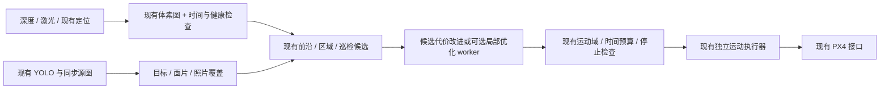

# ZJU FAST Lab 相关研究对电厂无人机自主探索与巡检的借鉴

调研日期：2026-10-27（Asia/Shanghai）。本项目代码基线：`4800616bbacbc7d5df33821e590d9ba4b10ca2a1`。本文件只做来源核查、适配分析与实验设计，不修改代码、配置、模型或任务框架，也不代表本轮执行了仿真验收。

本文通过用户指定的 [research 技能](../../.agents/skills/research/SKILL.md) 开展后台研究；来源限于作者论文、官方仓库及本地源码。GitHub 连接器和部分网页请求失败时，读取同一官方仓库的 `raw.githubusercontent.com` 原文补充核查，没有使用镜像文章替代作者来源。检索范围以与现有单机室内探索、有限视场、持续制动和目标巡检直接相关的成果为主，不声称穷尽实验室论文。

## 1. 结论与必须保持的边界

最值得借鉴的不是把某个 FAST Lab 系统整体搬进来，而是提取其轨迹优化、感知约束和模块分工，继续强化现有 P0/P1/P2。建议优先研究：**真实可见性驱动的观察点与偏航、具有有界计算时间的局部候选生成、定位方向误差与持续停止空间联合约束、以合格照片为最终依据的表面覆盖收益**。这些是本项目的适配建议，不是论文已经证明适用于本项目的结论。

保留以下框架和接口：

- ROS 2 / PX4；Python 负责现有定位适配、独立 UWB 输入及 YOLO，C++ 负责体素建图、规划、运动执行和巡检闭环。
- 主流程保持 `START → SAFE_TAKEOFF → HOVER_SCAN → EXPLORE → TARGETING_CYCLE → RETURN_HOME → LANDING`，保留 `IDLE / COMPLETE / FAULT` 辅助状态。
- 保留现有体素观测语义、采样时间与坐标 epoch 检查、规划 worker、独立运动执行器及 PX4 的位置控制接口。
- 未知空间用于评估探索收益；实际机体运动与停止包络必须处于最新验证的安全域。已确认起飞柱体作为独立依据使用，不能变成虚假传感器空闲证据；真实占据优先。
- 地图、速度、定位或时钟异常不能由高信息收益抵消；安全检查先筛选，收益函数只比较已经合格的候选。
- 正式仿真验收使用 **`/home/pawn/drone-simulation/Tools/simulation/gz/worlds/powerplant.sdf` 及其实际依赖模型**。测试小房间、点云演示、指令直接转里程计的演示不代替这一场景。

本地依据：[当前实施记录](../history/migration-status.md)、[P1 原理](../design/mapping-and-frontier.md)、[P2 原理](../design/motion-and-inspection.md)、[P2 验证边界](../validation/sitl-acceptance.md)、[构建关系](../../src/px4_powerplant_mission_cpp/CMakeLists.txt)。

## 2. 先分清成果归属

`ZJU-FAST-Lab` 是用户给出的官方组织。仓库出现在相关算法的引用链里，不等于该论文属于同一实验室；共同作者关系也不等于仓库托管在该组织。以下分类以官方 README、论文作者和仓库地址为依据。[官方组织](https://github.com/ZJU-FAST-Lab)

| 成果 | 本次核查的归属 | 年份口径与用途 |
|---|---|---|
| EGO-Planner | ZJU-FAST-Lab 官方仓库；Xin Zhou、Zhepei Wang、Chao Xu、Fei Gao | RA-L 2021，预印本 2020；局部轨迹优化。[论文](https://arxiv.org/abs/2008.08835)、[仓库](https://github.com/ZJU-FAST-Lab/ego-planner) |
| EGO-Swarm | ZJU-FAST-Lab 官方仓库 | ICRA 2021；可借鉴单机局部规划部分，多机协同不在当前任务范围。[仓库与论文信息](https://github.com/ZJU-FAST-Lab/ego-planner-swarm) |
| GCOPTER / MINCO | ZJU-FAST-Lab 官方仓库；Wang、Zhou、Xu、Gao | T-RO 2022；稀疏多项式轨迹表示、几何与动力学约束。[仓库](https://github.com/ZJU-FAST-Lab/GCOPTER)、[论文 DOI](https://doi.org/10.1109/TRO.2022.3160022) |
| visPlanner | ZJU-FAST-Lab 官方仓库；Qianhao Wang、Yuman Gao、Jialin Ji、Chao Xu、Fei Gao | IROS 2021；可见性约束轨迹优化及空中跟踪。[论文](https://arxiv.org/abs/2103.06742)、[仓库](https://github.com/ZJU-FAST-Lab/visPlanner) |
| Primitive-Swarm / Primitive-Planner | ZJU-FAST-Lab 官方仓库；Jialiang Hou 等 | T-RO 2025，41:3629–3648；仓库 2026 年更新不改变论文年份。[仓库](https://github.com/ZJU-FAST-Lab/Primitive-Planner)、[DOI](https://doi.org/10.1109/TRO.2025.3573667) |
| DPNet | Primitive-Planner 官方 README 列出的关联研究；Ruibin Zhang、Lun Pan、Zelong Xia、Jialiang Hou、Fei Gao | 2026-08-17 arXiv 预印本；本次未核实正式期刊/会议发表。RGB-D 死胡同预测与轨迹库筛选。[原文记录](https://arxiv.org/abs/2608.16640)、[官方关联入口](https://github.com/ZJU-FAST-Lab/Primitive-Planner) |
| Radar-Diffusion | ZJU-FAST-Lab 官方仓库 | RA-L 2024；毫米波雷达点云增强，仅作为传感器条件不匹配的例子。[论文](https://arxiv.org/abs/2403.08460)、[仓库](https://github.com/ZJU-FAST-Lab/Radar-Diffusion) |
| Fast-Planner / RAPTOR | 官方代码托管在 HKUST-Aerial-Robotics；Fast-Planner README 明确列出来自 ZJU FAST 的 Fei Gao，为合作关联成果 | Fast-Planner 对应 RA-L 2019、ICRA 2020 等工作；RAPTOR 为 T-RO 2021、预印本 2020。[官方说明](https://github.com/HKUST-Aerial-Robotics/Fast-Planner)、[RAPTOR 论文](https://arxiv.org/abs/2007.03465) |
| FUEL | HKUST-Aerial-Robotics；论文作者 Zhou、Zhang、Chen、Shen | RA-L 2021；列为本项目既有探索设计的重要外部对照，不标成 ZJU 官方成果。[论文](https://arxiv.org/abs/2010.11561)、[仓库](https://github.com/HKUST-Aerial-Robotics/FUEL) |
| FC-Planner | HKUST-Aerial-Robotics 与 SYSU STAR 相关作者团队 | ICRA 2024；表面覆盖的外部对照，不标成 ZJU 成果。[论文](https://arxiv.org/abs/2309.13882)、[仓库](https://github.com/HKUST-Aerial-Robotics/FC-Planner) |

原研究中的 FALCON（HKUST-Aerial-Robotics）、FASTER（MIT ACL）、SUPER（HKU MARS）继续保留各自来源；本报告不把它们合并计入 FAST Lab 成果。[FALCON](https://github.com/HKUST-Aerial-Robotics/FALCON)、[FASTER](https://github.com/mit-acl/faster)、[SUPER](https://github.com/hku-mars/SUPER)

## 3. 本项目已经实现的基线

下面以当前实现为基线，不能把 [旧研究的历史问题表](native-stack-research.md) 直接当作现有缺口。当前提交已包含 P2，不沿用旧架构普查中“P2 仍未提交”的时间截面结论。

| 能力 | 已实现内容 | 本次研究应继续回答的问题 |
|---|---|---|
| 数据与安全监督 | 时间、健康、协方差、epoch、起飞柱体、真实落地确认 | 是否能把经过验证的逐锚质量用于未来路线，而非只检查当前状态？ |
| 概率体素建图 | 精确 DDA、位姿插值、真实 CameraInfo、自适应深度采样、完整外参 | 是否需要逐体素来源、观测时间和方向，使地图支持更可靠的主动重观察？ |
| 增量查询 | 分类差分、前沿/净空局部更新、不可变地图快照 | 是否进一步维护前沿簇、区域门户和路线代价之间的依赖，减少大场景重复搜索？ |
| 探索 | 已知空闲侧视点、实际视场、观测停留、去返时间、区域配额及原因分类 | 是否用预测的有效成像收益与方向定位误差选择视点，而不只扩大候选数量？ |
| 运动 | 五次直线段、速度/加速度限制、实测停稳、独立 50 Hz 执行、持续停止包络 | 是否在同等安全条件下减少停车次数和计算尾延迟？ |
| 巡检 | RGB-D 注册、目标确认、稳定面片、质量与保存成功后提交覆盖 | 是否能更准确预测哪次观察会产出一张有效照片，并减少低收益补拍？ |

主要代码入口：[voxel_mapper_node.cpp](../../src/px4_powerplant_mission_cpp/src/voxel_mapper_node.cpp)、[planning_index.cpp](../../src/px4_powerplant_mission_cpp/src/planning_index.cpp)、[frontier_planner.cpp](../../src/px4_powerplant_mission_cpp/src/frontier_planner.cpp)、[mission_planning.cpp](../../src/px4_powerplant_mission_cpp/src/mission_planning.cpp)、[motion.cpp](../../src/px4_powerplant_mission_cpp/src/motion.cpp)、[motion_runtime.cpp](../../src/px4_powerplant_mission_cpp/src/motion_runtime.cpp)、[topology.cpp](../../src/px4_powerplant_mission_cpp/src/topology.cpp)、[inspection.cpp](../../src/px4_powerplant_mission_cpp/src/inspection.cpp)。上一轮记录的 316 个直接用例通过是软件基线；本轮没有重跑，完整指定场景飞行仍没有通过依据。[验证记录](../validation/sitl-acceptance.md)

## 4. 逐项借鉴：方法、适配位置和边界

### 4.1 EGO-Planner / EGO-Swarm：减少局部轨迹计算和不必要停车

**来源事实。** EGO-Planner 使用不依赖显式 ESDF 的梯度局部优化；官方 README 建议关注其后续 EGO-Swarm，并指向后者的 `ros2_version` 分支。EGO-Swarm 的多机异步规划是原系统内容，不能据此声称本项目已具备集群能力。其演示还存在把命令直接转为里程计的 `fake_drone` 路径，因此演示运行与 PX4 动力学验证必须分开。[EGO 论文](https://arxiv.org/abs/2008.08835)、[EGO 仓库](https://github.com/ZJU-FAST-Lab/ego-planner)、[EGO-Swarm 仓库](https://github.com/ZJU-FAST-Lab/ego-planner-swarm)

**本项目建议。** 优先借鉴“只对碰撞相关部分计算代价”和有限候选的局部改良，先优化已有直线骨架的捷径、视点终端方向和时间分配，保留现有五次轨迹作为可比较的基线。新的候选只有同时满足实际首局部段和完整去返检查，才允许交给执行器。

**接口与限制。** 入口在 `mission_planning.cpp → build_motion_plan()` 的后台准备路径。当前 [MotionPlan](../../src/px4_powerplant_mission_cpp/include/px4_powerplant_mission_cpp/motion.hpp) 保存的是 `QuinticMotionLeg`，任意 B-spline 不能直接塞入该类型。若以后采用曲线，必须扩展内部轨迹求值、连续扫掠验证、时间对齐和停止尾段连接测试；外层状态机、健康门控和 PX4 接口继续保持。论文的计算速度不能作为本机 p99 承诺，优化器“找到解”也不代替本项目的未知区禁入与停止检查。

### 4.2 GCOPTER / MINCO：统一考虑时间、平滑和机体可执行约束

**来源事实。** GCOPTER 基于 MINCO 稀疏轨迹表示，处理几何约束和状态/输入约束，官方实现还提供非线性阻力模型等模块。论文讨论的动力学与走廊优化比单纯限速度更丰富。[GCOPTER 官方说明](https://github.com/ZJU-FAST-Lab/GCOPTER)、[T-RO 论文](https://doi.org/10.1109/TRO.2022.3160022)

**本项目建议。** 先把“可通行几何走廊、真实执行时间、相机观察方向”作为同一候选的评价依据，比较减少停车是否真的节省总任务时间。对已有安全直线段，可研究时间分配与偏航停留的联合优化；只有实测表明停走损失成为瓶颈，再评估曲线后端。

**适配边界。** 优化走廊只能由本项目已经验证的空闲域生成，不能由世界 STL 真值预先提供。推力、倾角、角速度、阻力约束需要真实机体参数；不能用论文平台的动力学数值替换本项目配置。首次引入曲线时应继续保留停稳接纳新路线的策略，避免同时引入“移动中拼接、曲线优化、停止证明”三个变化。MINCO 与当前五次直线段不是同一个轨迹表示，也不因同为多项式就自动满足现有验证器。

### 4.3 Fast-Planner / RAPTOR：多条绕行选择，以及先看清再进入

**来源事实。** Fast-Planner 提供动力学搜索、B-spline 优化和不同拓扑类别的路径；RAPTOR 研究多拓扑路径引导、风险相关轨迹改良及主动偏航观察。官方 Fast-Planner README 仍把部分主动感知代码标为待发布，不能把论文方法全部等同于该仓库当前可直接运行的模块。[Fast-Planner](https://github.com/HKUST-Aerial-Robotics/Fast-Planner)、[ICRA 2020 论文](https://arxiv.org/abs/1912.12644)、[RAPTOR](https://arxiv.org/abs/2007.03465)

**本项目建议。** 在电厂设备遮挡处，为同一目标保留少量真正不同的绕行路线，例如设备左侧、右侧或满足净空的上方；每条路线分别核验去返时间和停止空间。靠近拐角时，可以在已知空闲处减速、停稳、偏航看向即将进入的一侧，再允许下一段运动。

这比在同一路线周围反复微调更有机会避免局部选择反复失败，但它是需要实验验证的推断。`topology.cpp` 的区域图可用于候选分流；`frontier_planner.cpp` 提供观察收益；`motion.cpp` 仍负责运动验证。不得把论文中的快速飞行或风险探索策略解释为允许本项目飞入尚未验证的未知空间。局部相机有视野不等于已经取得合格的新观测，P1 的观测确认条件继续保留。

### 4.4 visPlanner：让相机真正看得到目标

**来源事实。** visPlanner 对目标可见性和遮挡进行轨迹优化，作者以空中跟踪展示其方法；它属于 FAST Lab 官方成果。[论文](https://arxiv.org/abs/2103.06742)、[官方代码](https://github.com/ZJU-FAST-Lab/visPlanner)

**本项目建议。** 本项目目标通常是待巡检的静态表面，因此可借鉴可见性条件，而不引入动态目标追踪。候选观察点同时考虑：目标是否落在实际 RGB 视场内、相机到表面是否被设备遮挡、法向与视线夹角、目标在图中的尺度，以及停稳后的取图机会。

`inspection.cpp` 已有遮挡、法向和表面收益；下一步的差异应是把这些条件转为“预计合格照片新增覆盖”而非只增加一个可见性惩罚。预测失败时真实照片质检仍有最终否决权；低纹理不能仅凭一个清晰度数值断言失焦，也不能用预测可见面积提前记入已覆盖面积。可借鉴偏航优化，但仍以低倾角、位置与偏航变化获取视角，不增加大幅横滚/俯仰扫描。

### 4.5 Primitive-Swarm：给规划计算量一个可控上限

**来源事实。** 官方实现先生成运动原语库，再在运行时使用；论文面向大规模集群，代码依赖 ROS Noetic，库生成使用 TOPPRA 等工具。[Primitive-Planner](https://github.com/ZJU-FAST-Lab/Primitive-Planner)、[T-RO 2025](https://doi.org/10.1109/TRO.2025.3573667)

**本项目建议。** 可研究很小的单机动作候选集：短直行、停稳偏航、小范围侧移、向已知安全位置回退。对每个候选使用当前地图、误差上界和停止空间重新检查，再挑选收益较高的一条。库的价值在于减少在线搜索抖动，而非减少安全验证。

这里不建议直接导入多机库或采用其默认速度。预计算动作所用机体、速度、加速度、坐标和起始状态条件必须与任务匹配；实际状态不匹配时不能硬接。可先把原语用于 `HOVER_SCAN` 的有限短移候选和规划超时后的安全决策研究，并与当前停稳保持比较。无合法候选仍停下，不把“总能选出一个原语”作为任务要求。

### 4.6 FUEL：前沿簇、全局次序和局部视点可以继续分层

**来源事实。** FUEL 的关键是增量前沿信息结构及分层规划，连接前沿覆盖次序、局部视点与轨迹；它是 HKUST 官方成果，本项目可继续作为外部对照。[论文](https://arxiv.org/abs/2010.11561)、[官方仓库](https://github.com/HKUST-Aerial-Robotics/FUEL)

**本项目建议。** P1 已实现前沿/净空局部更新，P2 已有区域配额，因此下一步不应重复立项“加入增量前沿”。可研究：把前沿格聚成具有稳定身份的簇，记录簇与区域、门户和路径走廊的依赖；只有依赖区域改变时，重新计算对应视点和代价。

当前全量地图发布、解析以及部分路径搜索仍有成本。先记录各环节耗时，再决定优化哪个缓存。全局排序仍需服从返航预算和本地停止检查，不能为了访问更远簇而消除已有执行约束。区域/前沿缓存命中率提高也不等于探索完成率提高，必须同时检查错过候选与使用过期路径的比例。

### 4.7 FC-Planner：表面覆盖应由结构引导，但不能假装已知全场景

**来源事实。** FC-Planner 接收表面点云，提供骨架引导的空间划分、视点生成及覆盖规划；作者同时提供视点位姿迭代更新模块。它属于 HKUST/SYSU 相关团队，不是 ZJU 官方仓库。[论文](https://arxiv.org/abs/2309.13882)、[官方说明](https://github.com/HKUST-Aerial-Robotics/FC-Planner)

**本项目建议。** 针对在线已经确认的设备表面，按法向、连通性和遮挡关系分组，优先拍摄能补齐多个未覆盖面片的观察点，减少局部重复拍摄。区域尺度的结构信息可为候选生成提供方向，但最终仍用本项目实际相机模型与飞行可达性检查。

不能把完整 `power-plant.stl` 转成点云喂给规划器，然后宣称完成无先验自主探索。FC-Planner 的表面输入前提与本项目逐步发现目标不同；未观测区域大小未知，在线分母会增长，暂时遮挡和预算不足不能缩小覆盖责任。它适合指导已建模表面上的候选生成与访问排序，不能取代 YOLO 目标确认、曝光绑定和保存事务。

### 4.8 Radar-Diffusion 等学习感知：先核对传感器，不能用名称对号入座

**来源事实。** Radar-Diffusion 从毫米波雷达数据生成更接近激光雷达的点云，训练依赖成对数据；其 README 提示当前提供的是重训模型，量化结果与原论文不同。[论文](https://arxiv.org/abs/2403.08460)、[官方仓库](https://github.com/ZJU-FAST-Lab/Radar-Diffusion)

本项目的二维激光 `LaserScan` 和 UWB 距离不是这种毫米波输入。当前不应接入该网络，也不应把生成点云补全出的空洞当作已观测空闲。若今后增加毫米波设备，可另行研究观测辅助；学习输出最多先用于候选提示或风险标记，运动授权仍应由可追溯测量支持。真实逐锚数据不足时，也不应因实验室存在学习方法就跳过本项目“先测距与质量评估，再评估学习式 NLOS”的既定顺序。

### 4.9 DPNet：近期的死胡同预测思路，先用于风险提示

**来源事实。** 2026 年预印本使用 RGB-D 输入预测当前视场中潜在死胡同的相对距离与方位，再裁剪预定义的紧凑轨迹库。作者报告机载 50 Hz 重规划及仿真、实飞实验；这些是论文平台上的结果。官方 Primitive-Planner README 将其列为关联工作，本次没有验证其完整训练、部署链路或本项目中的效果。[DPNet 预印本](https://arxiv.org/abs/2608.16640)、[官方关联入口](https://github.com/ZJU-FAST-Lab/Primitive-Planner)

**本项目建议。** 电厂设备间的凹形遮挡和狭窄入口可能让局部高收益视点反复被选中。先利用已有区域门户、已知连通性、回退路线及重复失败记录，研究几何式死路风险和退出代价。再评估 RGB-D 学习预测能否提供额外收益；此处的场景适用性是待验证推断，不能从视觉模型直接断言当前碰撞模型中存在可飞通道。

学习结果可以降低候选优先级或否决候选，但不能给未知体素增加空闲证据。几何未知不等于死路，预测拒绝也可能错过真正入口，因此须记录误拒率、遗漏区域和回退成本。若增加学习组件，应独立比较“无死路先验、几何先验、几何加学习先验”，保持相同运动授权和算力条件。论文的 50 Hz **重规划**与本项目 50 Hz **运动参考发布**不是同一指标；当前任务决策约 10 Hz，不能把二者当作性能已经对齐。

### 4.10 Real-Time-SVSDF-Planner：保留为形状规划线索

官方仓库使用 “Any-shape Real-time Replanning via SVSDF” 描述功能，README 提供 ROS 1 / catkin 演示，并说明更完整版本将在论文终稿完成后发布。本次读取的 README 没有足以核实的论文题名、发表信息和量化基准，因此只将其列为代码线索，不计作已核验的正式论文成果。[官方 README](https://github.com/ZJU-FAST-Lab/Real-Time-SVSDF-Planner)

对本项目的启发是研究当前世界轴对齐保守盒在狭窄位置是否造成过多误拒，再决定是否需要更紧的完整机体扫掠表示。现阶段仍保留已实现的机体与停止包络验证；不能为了穿过视觉缝隙缩小真实机体尺寸，也不因上游支持任意形状就增加大倾角穿越流程。

## 5. 保持框架的接入方式与工程代价



图中新增研究只发生在既有模块内部及其输入输出附近；不能绕过 `Proof` 直接把论文轨迹发布给 PX4，也不能用另一套论文 FSM 争用 Offboard。

| 借鉴层级 | 对框架的影响 | 当前建议 |
|---|---|---|
| 评价函数、可见性、前沿簇依赖、候选排序 | 保留现有轨迹类型和执行器 | 优先；容易做同条件消融 |
| 有限运动原语与有界候选生成 | 需要定义初始状态、失效规则及预算，但可继续输出当前直线段 | 次优先；先测计算尾延迟是否值得 |
| EGO B-spline / MINCO 曲线 | 外层框架可保留，内部轨迹表示、连续验证和停止连接须扩展 | 待基线飞行和性能测量后单独评估；不属于简单替换函数 |
| 整套上游 FSM、仿真器、定位、机群通信 | 会改变既定框架、传感器与验收条件 | 本报告不建议导入 |

官方 EGO README 指向的 ROS 2 分支并不自动证明其支持本机 Jazzy、现有消息、QoS、时钟和 PX4 版本。本次直接读取该分支 README 返回 404，进一步查询分支 API 又遇到限流，因此仅确认官方文档存在这一指引，未确认该分支当前内容、可用性或编译结果。Fast-Planner、GCOPTER、Primitive-Planner、FUEL、FC-Planner 的已核查示例主要采用 ROS 1 / catkin。论文核心算法的借鉴与把整个软件栈运行起来是两项工作。[EGO 官方指引](https://github.com/ZJU-FAST-Lab/ego-planner)、[Fast-Planner](https://github.com/HKUST-Aerial-Robotics/Fast-Planner)、[GCOPTER](https://github.com/ZJU-FAST-Lab/GCOPTER)、[Primitive-Planner](https://github.com/ZJU-FAST-Lab/Primitive-Planner)、[FUEL](https://github.com/HKUST-Aerial-Robotics/FUEL)、[FC-Planner](https://github.com/HKUST-Aerial-Robotics/FC-Planner)

如以后复制源码，需按具体版本核对许可与依赖。当前已核查 EGO / EGO-Swarm / Fast-Planner / Primitive-Planner 为 GPLv3，GCOPTER 为 MIT，Radar-Diffusion 为 MIT；本轮没有引入这些源码，也不据此给出分发许可结论。其他模块应在实际引入前核对其 LICENSE 和内嵌依赖，不能从同一实验室推断同一许可。[EGO LICENSE](https://github.com/ZJU-FAST-Lab/ego-planner/blob/master/LICENSE)、[GCOPTER LICENSE](https://github.com/ZJU-FAST-Lab/GCOPTER/blob/main/LICENSE)、[Primitive LICENSE](https://github.com/ZJU-FAST-Lab/Primitive-Planner/blob/master/LICENSE)

## 6. 对本项目有价值的创新假设

以下是**待验证的项目贡献候选**。DDA、增量前沿、五次轨迹、多拓扑路径、MINCO、备用停止和表面覆盖都有既有研究基础；把它们装到一起不能直接声称学术首创。可发表性还需要围绕具体差异开展更系统的查新，并用控制变量实验说明收益来源。

### H1：把方向定位误差、观测收益与停止能力放入同一次视点决策

现有 P2 已使用完整协方差方向界检查当前运动。本研究增量应是：沿候选去返路线，使用**经过真实逐锚日志校准的**定位质量预测，识别可能导致停止空间不足或地图误差放大的路段；让视点选择在进入劣质区域前决定是否换路径、先重观察或保留更大余量。

可研究的评分形式为：

```text
先满足：轨迹与停止包络可验证、定位可信、观测时间有效、可返航
再比较：新增未知观测 + 预计合格表面覆盖
        - 实际去返时间 - 预测定位风险 - 重复失败代价
```

这只是本项目建议，不是某篇论文的原公式。没有逐锚数据时只能做明确标注的合成质量退化实验，不能宣称已经学到电厂 UWB NLOS 分布。对照组均保留相同 P0/P2 硬保护，比较加入方向质量预测是否减少无效进退、反复制动和覆盖时间；不能通过放松门限获得表面上的收益。

### H2：用“预计合格新增面积”连接探索与巡检

现有系统已经在拍照之后检查质量并提交覆盖。新增研究可以把曝光前的成像尺度、遮挡、法向、停留和可达性用于估计某个视点实际能补齐多少合格面片，再和未知空间观测一起排序。预测是排序依据，真实曝光及保存结果仍是最终证据。

例如可研究 `G_photo(v) = Σ_i A_i × visible_i(v) × (1-covered_i) × q_i(v)`：`A_i` 是稳定面片面积，`visible_i` 来自实际标定、遮挡与入射条件，`q_i` 是由曝光与照片日志校准的质量评分。未经概率校准时不能把 `q_i` 称为拍摄成功概率；未建模表面也不能凭空加入面积。这个建议公式服务于候选排序，不能直接写入真实覆盖账本。

上述收益沿现有阶段使用：`EXPLORE` 优先取得可靠未知观测和目标证据，`TARGETING_CYCLE` 选择能补齐合格覆盖的视点。它不要求增加顶层状态，也不改变当前巡检结束后进入 `RETURN_HOME` 的流程。

可检验假设：在相同预算、相同可达表面分母下，减少重拍与低信息照片，提高每分钟合格新增覆盖。必须分别报告预测误差、真实新增覆盖和失败重试，不得用预测分数代替实测成效。借鉴来源为 visPlanner 的可见性与 FC-Planner 的覆盖组织，项目差异是在线未知环境、目标确认、独立定位质量和照片提交闭环共同约束。

### H3：前沿簇—区域门户—安全路径的联合失效与重用

当前已经有增量索引、区域 ID、版本检查和局部地图依赖。新增研究应进一步把前沿簇、候选视点、区域门户、去返走廊与相机标定的依赖连接起来，使一次局部变化只重算真正受影响的代价；门户关闭或当前停止空间变化则立即重新验证。

可检验假设：在同样任务成功率和安全拒绝行为下，降低大型电厂场景的重复搜索次数、计划被作废的比例及 p99 延迟。单纯提高缓存命中率不够；必须同时统计错误复用、错过高收益视点和返航路线失效。FUEL 提供增量组织启发，RAPTOR 提供不同绕行选择启发，本项目的差异是把异步结果采用与持续停止依据绑定。

### H4：在连续制动约束下进行有界局部改良

保持现有保守五次轨迹为基线，使用很小的原语集或限定迭代次数的局部改良，为可安全捷径化的路线减少停车。若候选未在截止前通过完整验证，继续已有停止尾段并保持；不能临时发布未验证的“较好曲线”。

可检验假设：在相同速度、加速度、误差和停止条件下，降低总停车时间、计算长尾以及覆盖任务时间。若改变曲线表示，必须增加轨迹连续性与停止连接验证，这是一项明确的内部模块扩展；不能把上游优化器的收敛性当作整机安全结论。借鉴来源为 EGO、GCOPTER 和 Primitive-Swarm，项目贡献应落在有限算力、感知收益与可停止执行之间的可测权衡。

## 7. 指定 `powerplant.sdf` 的真实验收条件

### 7.1 本次读取到的场景事实

正式世界为 [powerplant.sdf](/home/pawn/drone-simulation/Tools/simulation/gz/worlds/powerplant.sdf)，包含原点的 `land_zone` 与位于 `(10,10,0)` 的 `power_plant_env`，后者引用 `model://power-plant`。以下来自本地 SDF 和二进制 STL 解析，不从场景截图猜测。

| 项目 | 当前内容 | 对评估的影响 |
|---|---|---|
| 电厂视觉 | `power-plant/model.sdf` 使用 `meshes/power-plant.stl`，scale 为 1 | 视觉结构需要与传感器和物理碰撞分别核对 |
| 电厂碰撞 | 同一模型只有未偏移的 `20 × 20 × 10 m` box；世界范围约为 x/y `[0,20]`、z `[-5,5]` | 视觉上的内部通道可能被实体盒堵住；也不能把视觉障碍都视为具有对应物理碰撞 |
| STL 范围 | 605740 个三角形；本地 x/y 约 `[-62.0390,62.0390]`，z `[-3.0000,8.7124]`；平移后世界 x/y 约 `[-52.0390,72.0390]` | 与 20 m 碰撞盒明显不一致；AABB 只说明外包范围，不能证明内部空闲或连通 |
| 起降标记 | `land_zone/model.config` 指向 `land_zone.sdf`，其中只有 z≈0.05 m 的 `0.4 × 0.4 m` visual plane，没有 collision | 贴图不能确认起飞柱体；原点还位于上述电厂碰撞盒边角，非零机体包络可能相交 |
| 地面 | `ground_plane` 的 plane 声明 size 为 `100 × 100 m`，以原点为中心的名义尺寸为 x/y `[-50,50]` | 名义尺寸小于视觉模型 AABB；实际接地与物理碰撞范围须核对引擎行为，不能仅凭 plane size 断言边界外没有地面 |
| 烟雾 | `smoke_emitter` 位于 `(5,10,8)`，发射体 size `10,10,15`，rate 8，lifetime 20 | 只确认存在粒子效果；对 RGB、深度、激光的实际测量影响需要运行测量，不能直接称为真实烟雾传感器退化模型 |
| 当前任务 ROI | 共享配置约为 x `[-24,34]`、y `[-9,49]`、z `[3.5,7]` | 当前任务边界不等于整个电厂模型；全场覆盖分母必须预先明确 |

模型来源：[power-plant/model.sdf](/home/pawn/drone-simulation/Tools/simulation/gz/models/power-plant/model.sdf)、[land_zone/model.config](/home/pawn/drone-simulation/Tools/simulation/gz/models/land_zone/model.config)、[land_zone.sdf](/home/pawn/drone-simulation/Tools/simulation/gz/models/land_zone/land_zone.sdf)、[共享参数](../../src/px4_powerplant_mission/config/powerplant.yaml)。本次只记录这些事实，不修模型或参数。

为确保后续是同一个场景，记录本次读取文件的 SHA256：

| 文件 | SHA256 |
|---|---|
| `worlds/powerplant.sdf` | `df40f76d3f332342da5950375dfeefe303c070f27e3ff5f1d079c94450d91bf9` |
| `models/power-plant/model.sdf` | `2552d6f532e8279b44bcf909e6fbb9060b03d42edcbe9a51dbc672cd69494067` |
| `models/power-plant/meshes/power-plant.stl` | `076476fcef7535cb1c24d8fc7dffab21987d906f7464a3dbf91374f7d49cdf87` |
| `models/land_zone/land_zone.sdf` | `38685b62a38ab7dd699c968cee766b665112ccb0c5edffc077357f63fd581f07` |

这些 hash 是此次文档的观测记录，不代表文件正确或验收通过。若未来修正碰撞几何，应保存原始与修正版本及差异，把修正后的指定电厂场景作为新的统一基线；不能在不同算法之间使用不同碰撞模型，或把简化房间换名后当作电厂。

### 7.2 现有运行器与用户要求存在明确差异

[run_acceptance.py](../../validation/sitl/run_acceptance.py) 当前在启动及评估读取处使用 `validation/sitl/worlds/{scenario}.sdf`（核查时约第 258、467 行）。这些文件也叫 `world name="powerplant"`，但不是上述正式 `powerplant.sdf`。因此现有 `p2_room`、`p2_two_rooms` 报告不能作为指定电厂场景验收报告；也不能仅根据 `/world/powerplant/...` 话题名判断加载了正确文件。

后续运行器适配应让启动、真值评估、碰撞检查和 manifest 指向同一个实际世界及其依赖。**本轮没有修改运行器，也没有声称它已经提供新的 `--world` 参数。** 简化世界仍可用于算法单测和故障复现，但最终任务完成、探索覆盖、巡检覆盖、制动和性能结论必须来自指定电厂场景。

### 7.3 正式实验开始前应明确的内容

1. **几何一致性。** 核对视觉、深度/激光射线及物理 collision；确认哪些设备外部区域和内部通道真实可达。在碰撞箱与视觉明显不一致的当前版本上，不能宣称通过电厂内部穿行验收。
2. **起飞与任务范围。** 明确实际出生点、机体完整包络、地面接触与确认柱体；不能复制 `p2_room` 的安全柱体。固定业务 ROI，明确任务是设备外部巡检、内部通道探索还是指定局部区域；不把模型 AABB 当作全部应探索自由空间。
3. **目标真值。** STL 不自带 YOLO 类别、设备实例 ID 和合格照片目标。应由评估器维护独立的设备/表面标注及可见性真值；导航器只能读取实际图像、检测及测距，不能取得真值目标坐标或预置航点。
4. **可重复条件。** 固定实际 world、依赖模型、机体、传感器、PX4、消息版本、配置和随机种子；记录系统负载及有效帧率。降低图像分辨率/频率的实验必须单列，不能与原传感器负载合并。
5. **烟雾语义。** 先测有粒子时的 RGB/深度/激光差异；若只影响渲染，实验只能说明视觉变化，不得扩写为验证毫米波穿烟或真实激光散射模型。

## 8. 在同一电厂场景内验证创新，而不靠换场景获得收益

所有候选方法都继承相同 P0 安全门控、未知空间规则、返航约束和照片提交规则。基线为当前 P2，不把尚未实现的论文系统标作已运行基线；未来若只实现某个论文启发组件，应称“基于该思路的组件对照”，不能冒充复现整篇论文。

| 组别 | 唯一主要变化 | 需要回答的问题 |
|---|---|---|
| B0 | 当前 P0/P1/P2，固定同一配置 | 指定场景能否完整执行，瓶颈在哪里？ |
| A1 | 加入 H1 的路线质量预测；其它收益和限值相同 | 是否减少因定位质量变化导致的无效进退与制动？ |
| A2 | 加入 H2 的预计合格新增面积 | 是否以更少重拍获得同等真实覆盖？ |
| A3a | 只加入 H3 的依赖缓存，保持候选集合相同 | 是否减少重复规划，同时保持正确失效？ |
| A3b | 只增加少量不同绕行候选，保持原缓存策略 | 是否减少局部反复失败，额外计算代价是否可接受？ |
| A4a | 只加入 H4 的有限原语候选，保持现有轨迹类型 | 是否减少候选生成长尾，同时保持停止依据有效？ |
| A4b | 只加入限定预算的捷径/时间分配改良，不同时改变原语或曲线类型 | 是否减少停车与任务时间，截止超时如何影响有效收益？ |
| A-all | 逐项有效后再组合 | 单项收益能否共存，是否出现相互干扰？ |

建议预先固定若干起点/初始偏航和传感器噪声种子，在**同一个电厂 world**内配对重复运行；先做小规模试验估计方差，再决定正式样本量。起点必须经过同等几何核验，不能把不同算法安排到难度不同的区域。任何未完成、超时、FAULT 和不合格照片都保留，不仅统计成功样本。

必须报告的指标：

- **任务结果：** 完整阶段顺序、真实落地并上锁、失败原因、是否需要人工干预。任务 `COMPLETE` 与巡检 `REACHABLE_MODELED_COMPLETE / PARTIAL / UNCONFIRMED` 分列。
- **探索：** 在事先固定的可达业务 ROI 中，达到给定真实观测覆盖所需时间、路程、重复访问和遗漏区域；真值仅供评估。未知空间首次发现收益与已建图表面覆盖不要混为同一个百分比。
- **巡检：** 合格且保存成功的新增表面面积、分母增长、重拍率、重复照片、未确认/遮挡/不可达范围。在线“可达已建模表面覆盖”与评估器“标注任务目标覆盖”分列，避免只发现一小块就得到高百分比。
- **运动：** 采样时间对齐的跟踪误差、速度/加速度、停稳等待次数、停止距离、反应延迟、停止包络有效率。实际障碍生效时间、观测融合时间、执行输入与制动触发应能对应，否则物理制动结论保持 `UNCONFIRMED`。
- **计算：** 建图、地图解析、候选生成、轨迹准备的 CPU/内存以及 p50/p95/p99/max；运动参考发布间隔、导航与图像年龄、ROS 仿真时间与墙钟的关系。平均耗时降低不能掩盖超时长尾。
- **感知：** 在原场景真实图像上评估目标检测、RGB-D 注册残差、有效深度比例和照片质量。检测重放仅验证下游逻辑，真实 YOLO 的零检测或源图同步通过都不能替代目标识别能力。

建议首先保持当前速度、加速度和制动限值进行算法对照，避免把“调快了参数”写成算法创新。若研究参数敏感性，单列实验并报告同一安全约束下的可行范围。完整实体碰撞、截止时间或停稳判据失败时，不能仅凭覆盖率提高判定改进有效。

## 9. 推荐的后续研究顺序

1. **先建立指定电厂场景的可信基线。** 解决视觉/碰撞、实际 world 选择、起飞位置、ROI 和目标评估标注的不一致，获得 B0 全链路记录；本轮仅识别这些前置事项。
2. **优先做不改变轨迹类型的改进。** 在 `inspection.cpp`、`frontier_planner.cpp` 和 `mission_planning.cpp` 中研究可见性与合格面积收益，测量前沿簇和区域依赖缓存的价值。
3. **在真实日志支持后研究定位感知决策。** 先有逐锚测距、质量、时间和场景位置对应关系，再谈 NLOS 空间预测；在此之前使用明确标注的合成退化对照。
4. **只在测得瓶颈后评估新轨迹后端。** 若主要耗时来自渲染、整图传输或图片处理，换 EGO/MINCO 未必解决问题；若停走和局部轨迹质量确为主要瓶颈，再比较原语或优化后端。

最有希望形成项目特色的，是“**在未知工业场景中，依据真实观测和定位质量，自主选择既能安全执行、又能产出合格巡检证据的下一步动作**”。它需要以指定电厂场景中的配对实验支持，当前不宣称新的学术首创、论文级性能提升或实机飞行保证。

## 10. 主要来源索引

| 编号 | 一手来源 | 本报告使用范围 |
|---|---|---|
| S1 | [ZJU-FAST-Lab 官方组织](https://github.com/ZJU-FAST-Lab) | 官方仓库归属及检索入口；更新时间不作为论文年份 |
| S2 | Xin Zhou et al., *EGO-Planner: An ESDF-free Gradient-based Local Planner for Quadrotors*, RA-L 2021。[arXiv](https://arxiv.org/abs/2008.08835)、[DOI](https://doi.org/10.1109/LRA.2020.3047728)、[官方仓库](https://github.com/ZJU-FAST-Lab/ego-planner) | ESDF-free 局部优化及上游实现边界 |
| S3 | Xin Zhou et al., *EGO-Swarm: A Fully Autonomous and Decentralized Quadrotor Swarm System in Cluttered Environments*, ICRA 2021。[官方仓库及论文入口](https://github.com/ZJU-FAST-Lab/ego-planner-swarm) | ROS 2 分支指引、单机部分借鉴、演示动力学边界 |
| S4 | Zhepei Wang et al., *Geometrically Constrained Trajectory Optimization for Multicopters*, T-RO 2022, 38(5):3259–3278。[DOI](https://doi.org/10.1109/TRO.2022.3160022)、[GCOPTER](https://github.com/ZJU-FAST-Lab/GCOPTER) | MINCO、走廊与动力学约束、MIT 许可 |
| S5 | Qianhao Wang et al., *Visibility-aware Trajectory Optimization with Application to Aerial Tracking*, IROS 2021。[arXiv](https://arxiv.org/abs/2103.06742)、[visPlanner](https://github.com/ZJU-FAST-Lab/visPlanner) | 可见性与遮挡启发，不等同于静态巡检完整方法 |
| S6 | Jialiang Hou et al., *Primitive-Swarm: An Ultra-Lightweight and Scalable Planner for Large-Scale Aerial Swarms*, T-RO 2025, 41:3629–3648。[DOI](https://doi.org/10.1109/TRO.2025.3573667)、[官方代码](https://github.com/ZJU-FAST-Lab/Primitive-Planner) | 预计算原语、在线有界候选；不移植机群框架 |
| S7 | Boyu Zhou et al., *Robust and Efficient Quadrotor Trajectory Generation for Fast Autonomous Flight*, RA-L 2019；*Robust Real-time UAV Replanning Using Guided Gradient-based Optimization and Topological Paths*, ICRA 2020。[官方 Fast-Planner](https://github.com/HKUST-Aerial-Robotics/Fast-Planner)、[ICRA 原文](https://arxiv.org/abs/1912.12644) | 合作归属、动力学搜索和多拓扑路径 |
| S8 | Boyu Zhou et al., *RAPTOR: Robust and Perception-aware Trajectory Replanning for Quadrotor Fast Flight*, T-RO 2021，预印本 2020。[arXiv](https://arxiv.org/abs/2007.03465)、[DOI](https://doi.org/10.1109/TRO.2021.3071527) | 风险相关感知与偏航；不能继承论文性能 |
| S9 | Boyu Zhou, Yichen Zhang, Xinyi Chen, Shaojie Shen, *FUEL: Fast UAV Exploration Using Incremental Frontier Structure and Hierarchical Planning*, RA-L 2021, 6(2):779–786。[arXiv](https://arxiv.org/abs/2010.11561)、[官方代码](https://github.com/HKUST-Aerial-Robotics/FUEL) | 外部前沿组织对照，归属纠正 |
| S10 | Chen Feng et al., *FC-Planner: A Skeleton-guided Planning Framework for Fast Aerial Coverage of Complex 3D Scenes*, ICRA 2024:8686–8692，预印本 2023。[arXiv](https://arxiv.org/abs/2309.13882)、[官方代码](https://github.com/HKUST-Aerial-Robotics/FC-Planner) | 外部表面覆盖对照及已给定表面点云前提 |
| S11 | *Radar-Diffusion*, RA-L 2024。[arXiv](https://arxiv.org/abs/2403.08460)、[官方代码](https://github.com/ZJU-FAST-Lab/Radar-Diffusion) | 毫米波数据前提与不能直接替代真实空闲证据 |
| S12 | Ruibin Zhang, Lun Pan, Zelong Xia, Jialiang Hou, Fei Gao, *DPNet: Efficient Dead-End Prediction and Avoidance for Vision-Based UAV Navigation*, arXiv 2026-08-17。[原文](https://arxiv.org/abs/2608.16640)、[官方关联入口](https://github.com/ZJU-FAST-Lab/Primitive-Planner) | 近期 RGB-D 死胡同预测；未核实正式发表，不把论文重规划频率等同于本项目发布频率 |
| S13 | [Real-Time-SVSDF-Planner 官方仓库](https://github.com/ZJU-FAST-Lab/Real-Time-SVSDF-Planner) | 任意形状重规划的代码线索；本次没有核实关联正式论文与完整性能数据 |
| L1 | [P1 实施](../design/mapping-and-frontier.md)、[P2 实施](../design/motion-and-inspection.md)、[验证](../validation/sitl-acceptance.md)、[迁移记录](../history/migration-status.md) | 当前已经实现的能力与飞行验收边界 |
| L2 | [实际 powerplant.sdf](/home/pawn/drone-simulation/Tools/simulation/gz/worlds/powerplant.sdf)、[power-plant 模型](/home/pawn/drone-simulation/Tools/simulation/gz/models/power-plant/model.sdf)、[现有运行器](../../validation/sitl/run_acceptance.py) | 本地场景事实与正式验收缺口 |

本轮未复制上游算法源码、未更换框架、未调整飞控参数、未启动仿真。所有改进幅度、创新假设和正式电厂场景验收结论均留待后续实验。
